<picture>
  <source media="(prefers-color-scheme: dark)" srcset="assets/hero-dark.svg">
  <source media="(prefers-color-scheme: light)" srcset="assets/hero-light.svg">
  
</picture>

[](https://github.com/Aboudjem/contextify/actions/workflows/validate.yml)
[](LICENSE)
[](https://github.com/Aboudjem/contextify/stargazers)

English | [Français](READMEs/fr.md) | [Español](READMEs/es.md) | [日本語](READMEs/ja.md) | [简体中文](READMEs/zh-CN.md)

**Tell every coding agent how your repo works. Then prove it is still true.**

contextify is an Agent Skill that writes short repository instructions from files your agent reads. It records the evidence so a local script can report when those instructions need another look.

## What it does

- Writes one `AGENTS.md`, with thin pointers for your other agents. Targets 20, 40 or 60 lines by repository size; refuses files above 150 lines.
- Records commands and paths against repository evidence. Unsupported claims must be labelled `unverified` or omitted; a separate agent reviews the draft.
- Checks for drift without calling a model. Fresh checks are silent; updates show a diff and preserve human content outside the managed blocks.
- Adds focused architecture or workflow notes when the repository needs them, with links from `AGENTS.md`. Reuses accurate existing docs first.

## Install

In Claude Code:

```bash
claude plugin marketplace add Aboudjem/contextify
claude plugin install contextify@contextify-marketplace
```

For other agents, install the skill:

```bash
npx skills add Aboudjem/contextify
```

Then ask your agent to run contextify on the current repository. In Claude Code, use:

```text
/contextify init
```

Review the proposed diff, then commit the generated context files and `.contextify/` metadata. The scripts need Git, POSIX shell tools, Bash and Python 3.11+; there are no Python package dependencies or MCP server. The installer uses Node.js through `npx`. [Editor-specific setup](docs/editors.md).

## What you get

Historical **v0.1.0** example; this is not evidence of the 0.2.0 extension. Excerpt from a real run on an isolated copy of HazeLab, a Next.js app, on 2026-09-17. Codex drafted the instructions and Contextify wrote the files. [Full output and evidence](examples/nextjs/README.md).

```markdown
## Commands
- Development from the repository root: `pnpm run dev`.
- Build: `pnpm run build`; this generates the Prisma client before building Next.js.
- Lint: `pnpm run lint`.
## Testing
- No test script is declared in `package.json`; do not assume a package-manager test command exists.
- `vitest.config.ts` selects jsdom and discovers TypeScript tests under the tests directory.
```

Removing the quoted `lint` script in that copy produced this notice:

```text
contextify: drift
Scope    .
Stale    AGENTS.md:7 references pnpm run lint
Changed  package.json#scripts
Changed  provenance:package.json:10
Removed  script lint
Files    0 written
Next     /contextify update
Accept   unavailable until the stale command is corrected
```

The source repository was not changed. See the [run record and validation limits](evals/dogfood.md).

## What it writes

Defaults below describe newly generated files. Human content already present still counts toward the budget.

| File | Reader | Lines |
| --- | --- | --- |
| `AGENTS.md` | Codex, Cursor and other agents supporting this convention | Target 20/40/60; maximum 150 |
| `CLAUDE.md` | Claude Code, through `@AGENTS.md` | 4 by default |
| `GEMINI.md` | Gemini CLI, through `@AGENTS.md` | 3 |
| `.cursor/rules/contextify.mdc` | Cursor; optional because it also reads `AGENTS.md` | 9 |
| `.github/copilot-instructions.md` | GitHub Copilot | 4 |
| `docs/context/architecture.md` | Optional map of components, boundaries and data flow | Maximum 120 |
| `docs/context/workflows.md` | Optional development, testing and release procedures | Maximum 120 |
| `.contextify/evidence.json` | Contextify's evidence records | Depends on repository |
| `.contextify/stamp.json` | Contextify's freshness check | Depends on repository |

Only selected targets get pointer files. Supporting documents are optional, capped at 120 lines each, and read when relevant. See [supporting documents](docs/supporting-docs.md) and [loading rules](docs/editors.md).

## How it works



| Mode | What happens |
| --- | --- |
| `init` | Read the repository, draft instructions, review evidence, show a diff, then write and check. |
| `update` | Re-read evidence and revise affected managed content. Human edits outside the block survive; edits inside it raise a conflict. |
| `check` | Compare evidence with the committed stamp and resolve quoted commands and paths. Nothing is written. |
| `accept` | Refresh metadata when the instructions are still right. Dead claims are refused; prose stays unchanged. |

`init --dry-run` shows the proposed files and their line/byte costs. `--yes` skips routine questions, never a managed-block conflict or a hard ceiling.

The plugin registers no session-start hook by default. The installer proposes Git `pre-commit` and `pre-push` checks; applying files and activating them are explicit steps. From a Contextify checkout, with the target repository path supplied:

```bash
bash skills/contextify/scripts/install_hooks.sh /path/to/repo
bash skills/contextify/scripts/install_hooks.sh --yes --activate /path/to/repo
```

Git checks inspect the current working tree, not the staged snapshot or pushed commits. They warn by default and never rewrite files; strict mode is optional. Activation refuses to replace existing hooks or a custom/global hooks path. [Installation, migration and CI](docs/hooks.md).

## Compared with

This is a narrow comparison of sources inspected on **2026-09-16**, not a claim about every current release. The [full matrix and source paths](docs/comparison.md) document the scope and trade-offs.

| Tool | What to compare |
| --- | --- |
| contextify | Evidence records, one instruction source, enforced line ceiling, deterministic drift checks and managed-block updates. |
| ruler / rulesync | Broader configuration distribution across agents; rulesync also imports existing configurations. |
| ClaudeForge | Claude-focused organization and examples for different project sizes. |
| agents-md-generator | Small seed template with `CLAUDE.md` symlinked to `AGENTS.md`. |

## Good to know

A resolved command is one whose declaration or target exists. Contextify does **not** run it to prove it works. Repository evidence can be stale, and the deterministic resolver does not understand every shell expression or build system. Read the [limits](docs/limits.md).

An [ETH Zurich study](https://arxiv.org/abs/2602.11988) found no general task-success improvement from repository context files and an average inference-cost increase above 20%. Contextify has no measured task-success advantage. Keep only instructions that prevent a concrete mistake.

The hook never rewrites files. Generation and revision use your coding agent; the freshness check runs locally without a model or network request. The [dogfood report](evals/dogfood.md) separates script evidence from host-agent behavior, including any Claude validation left untested.

## Learn more

[Quickstart](docs/quickstart.md) · [Worked examples](examples/README.md) · [Hooks and CI](docs/hooks.md) · [FAQ](docs/faq.md) · [Evaluation](evals/README.md) · [Design decisions](docs/design/DECISIONS.md)

[Contributing](CONTRIBUTING.md) · [Security](SECURITY.md) · [Changelog](CHANGELOG.md) · [MIT license](LICENSE) · [10x plugin hub](https://github.com/Aboudjem/10x)

Run these local checks for the revision you are reviewing. Historical results belong to the [v0.1.0 evaluation](evals/dogfood.md); they do not establish that new changes passed.

```bash
python3 tests/test_ctx_check.py
python3 tests/test_verify_claims.py
python3 tests/test_hooks.py
python3 tests/test_regressions.py
python3 tests/test_supporting_docs.py
python3 tests/test_manifests.py
python3 evals/check_skill.py skills/contextify/SKILL.md
```