<picture>
  <source media="(prefers-color-scheme: dark)" srcset="assets/hero-dark.svg">
  <source media="(prefers-color-scheme: light)" srcset="assets/hero-light.svg">
  
</picture>

[](https://github.com/Aboudjem/contextify/actions/workflows/validate.yml)
[](LICENSE)

English | [Français](READMEs/fr.md) | [Español](READMEs/es.md) | [日本語](READMEs/ja.md) | [简体中文](READMEs/zh-CN.md)

**One AGENTS.md for your agents, checked with zero tokens.**

contextify writes one short instruction file and warns when a line is out of date.

| Time saved | Context kept | Tokens saved |
|:--|:--|:--|
| The warning names the file, the line and the missing command. See the sample below. | One file of 20, 40 or 60 lines, by repo size. The `CLAUDE.md` pointer is 4 lines. | The check for stale lines is a local script. It calls no model, so it costs zero tokens. |

**Works with:** any agent that reads skills. Tested: Claude Code, Codex.

Not tied to one model: the check is plain Bash and Python.

`AGENTS.md` is the file of instructions that coding agents read. Use contextify when your repo has none, or when it names old commands.

You get one short file and a warning when a line goes stale.

```bash
npx skills add Aboudjem/contextify -g
# then, in your agent: contextify init
```

This installs it for all your projects. Each agent's own command is in [Install](#install).

### Sample report

A real run on 2026-11-17. contextify 0.3.0 wrote `AGENTS.md` for a small Python service.

Then the `test-health` target was deleted from its `Makefile`. Version 0.3.3 prints this:

```text
contextify: drift
1. Run /contextify:contextify update to fix AGENTS.md:6 (make test-health)
2. Review the diff it shows before it writes
3. Commit the context files with .contextify/
Agents     outside Claude Code, ask for "contextify update"
Scope      .
Stale      AGENTS.md:6 references make test-health
Unverified AGENTS.md:6 python3 -m unittest tests.test_health
Changed    makefile#targets
More       +3 findings
Files      0 written
Accept     unavailable until the stale command is corrected
```

A fresh repo prints nothing. The run's files and stamp ship with the example, so you can replay it:

```bash
sh examples/python-service-0.3.0/replay.sh
```

[Full run, files and the edit that caused it](examples/python-service-0.3.0/README.md).

**Limit:** it checks commands, targets and files, not prose, and never runs them.

## Install

**Pick your agent.** Each command installs contextify for all your projects.

<p align="center">
  <a href="#install-claude-code"></a>
  <a href="#install-codex"></a>
  <a href="#install-cursor"></a>
  <a href="#install-gemini-cli"></a>
  <a href="#install-github-copilot"></a>
  <a href="#install-opencode"></a>
</p>

<a id="install-claude-code"></a>**Claude Code**, tested. From your terminal:

```bash
claude plugin marketplace add Aboudjem/10x && claude plugin install contextify@10x
```

Then, inside your repository, ask for a first draft:

```text
/contextify:contextify init
```

<a id="install-codex"></a>**Codex**, tested:

```bash
npx skills add Aboudjem/contextify -g -a codex
```

<a id="install-cursor"></a>**Cursor**, install tested:

```bash
npx skills add Aboudjem/contextify -g -a cursor
```

<a id="install-gemini-cli"></a>**Gemini CLI**, install tested:

```bash
npx skills add Aboudjem/contextify -g -a gemini-cli
```

<a id="install-github-copilot"></a>**GitHub Copilot**, install tested:

```bash
npx skills add Aboudjem/contextify -g -a github-copilot
```

<a id="install-opencode"></a>**OpenCode**, install tested:

```bash
npx skills add Aboudjem/contextify -g -a opencode
```

Only this project: drop `-g`. Another agent: find its `-a` code in [editor setup](docs/editors.md).

Outside Claude Code there is no `/contextify:` prefix. Ask in words: "contextify init", "contextify update".

You need Git, Bash and Python 3.11 or newer. No Python packages, no MCP server, no network call from the scripts.

## How it works

Know when your agent instructions point at something gone. One AGENTS.md for all your agents and a local check that costs no tokens.

You delete a Makefile target, rename a script or move a test. Your agents still follow the old instructions. Each wrong try wastes a turn. contextify shows you the old line first:

1. `init` reads your repo and drafts `AGENTS.md`. A separate agent reviews each line against its source.
2. You see the diff. contextify writes the files and a stamp, a record of what each line names.
3. The drift check compares the repo with the stamp. Drift means a line names something that is gone.



| Mode     | What happens                                                                               |
| -------- | ------------------------------------------------------------------------------------------ |
| `init`   | Read the repo, draft instructions, review the evidence, show a diff, then write and check. |
| `update` | Re-read the evidence and revise the managed block. Your edits outside the block survive.   |
| `check`  | Compare the evidence with the committed stamp. Nothing is written.                         |
| `accept` | Refresh the stamp when the instructions are still right. Lines naming missing things are refused. |

What it writes:

| File                                         | Reader                                                   | Lines                            |
| -------------------------------------------- | -------------------------------------------------------- | -------------------------------- |
| `AGENTS.md`                                  | Codex, Cursor and other agents that read this convention | Target 20, 40 or 60; maximum 150 |
| `CLAUDE.md`                                  | Claude Code, through `@AGENTS.md`                        | 4 by default                     |
| `GEMINI.md`                                  | Gemini CLI, through `@AGENTS.md`                         | 3                                |
| `.cursor/rules/contextify.mdc`               | Cursor; optional, since Cursor also reads `AGENTS.md`    | 9                                |
| `.github/copilot-instructions.md`            | GitHub Copilot                                           | 4                                |
| `docs/context/architecture.md`               | Optional map of components and data flow                 | Maximum 120                      |
| `docs/context/workflows.md`                  | Optional build, test and release steps                   | Maximum 120                      |
| `.contextify/evidence.json` and `stamp.json` | The drift check                                          | Depends on the repo              |

Codex and Cursor read `AGENTS.md` as it is. Only the agents you pick get a pointer file. Every factual line maps to a source file and line.

The drift check exits 0 with no output when the repo is fresh. On drift it prints the notice above and still exits 0. It never rewrites a file.

Exit codes, measured in bash on 2026-11-17 with 0.3.3:

| Mode                                             | Fresh                   | Drift                   | No stamp yet            | Check broke |
| ------------------------------------------------ | ----------------------- | ----------------------- | ----------------------- | ----------- |
| plain, `--strict`, `--json`, `--hook <agent>`    | 0, no output            | 0, the notice           | 3, the `init` notice    | 1           |
| `--ci`                                           | 0, `contextify: fresh`  | 0, the notice           | 0, the `init` notice    | 1           |
| `--git`                                          | 0, no output            | 0, the notice on stderr | 0, the notice on stderr | 1           |
| `--ci --strict`, `--git --strict`                | 0                       | 1                       | 1                       | 1           |

The notice is at most 12 lines and 2,048 bytes. `--json` prints it as one line of JSON. `--strict` alone never changes the exit code. It only counts unverified claims as drift.

Git checks are opt-in. At the end of `init` the skill offers to install `pre-commit` and `pre-push` checks. From a clone of this repo you can also run:

```bash
bash skills/contextify/scripts/install_hooks.sh --yes --activate /path/to/repo
```

They warn by default and refuse to replace existing hooks. Add `--strict` to block a commit or push on drift.

Activation refuses when a global `core.hooksPath` is set, since it would hide your other hooks. Call `ctx-check --git` from the hook manager you already use instead.

For a CI job that fails on drift, generate the workflow in strict mode. Its step runs `ctx-check --ci --strict`. That also fails on a missing stamp and on any unverified claim, even in a repo with no other drift:

```bash
bash skills/contextify/scripts/install_hooks.sh --strict --targets github --yes /path/to/repo
```

[Hooks and CI](docs/hooks.md).

### Run the drift check by hand

It prints nothing when the repo is fresh. Run it from the root of your repository.

Installed as a plugin:

```bash
sh "$(ls -d ~/.claude/plugins/cache/10x/contextify/*/ | sort -V | tail -1)skills/contextify/scripts/ctx-check"
```

Installed with `npx skills add -g` (Codex, Cursor, Gemini CLI, Copilot and OpenCode use `~/.agents/skills`):

```bash
sh ~/.agents/skills/contextify/scripts/ctx-check
```

For a Claude Code skills install, the folder is `~/.claude/skills/contextify` instead. Without `-g`, the folder sits in your repo: `.agents/skills/contextify`. Add `--ci --strict` to make drift exit 1.

Installing the skill does not count as drift. The check skips contextify's own copy under any agent folder and `skills-lock.json`. Other skills you add to your repo's `.agents/skills` do count, as a `tree#depth2` change. To ignore them, add this one line:

```bash
echo ".agents/" >> .gitignore
```

## Proof

One command runs every suite, the skill contract and this repo's own drift check:

```bash
make test
```

It printed this on 2026-11-17 (one summary line per suite, in run order):

```text
tests/test_ctx_check.py        128/128 checks passed
tests/test_verify_claims.py     30/30 checks passed
tests/test_hooks.py             Ran 22 tests, OK
tests/test_regressions.py       Ran 25 tests, OK
tests/test_supporting_docs.py   Ran 16 tests, OK
tests/test_manifests.py        155/155 checks passed
evals/check_skill.py           114/114 checks passed
make dogfood                   PASS: ctx-check is fresh and silent
                               29 claims, 0 stale, 0 unverified
```

CI runs the same `make test` on every push and pull request. This repo's own `AGENTS.md` was written by contextify, so the last step fails on drift.

## Works with

| Agent          | Install path                                             | Tested                                                                                                                  |
| -------------- | -------------------------------------------------------- | ----------------------------------------------------------------------------------------------------------------------- |
| Claude Code    | `claude plugin install contextify@10x`                   | 2026-11-17: plugin install, then a full `init` run ([run record](examples/python-service-0.3.0/README.md))              |
| Codex          | `npx skills add Aboudjem/contextify -g -a codex`         | 2026-11-17: skill install, then Codex ran the drift check ([run log](examples/python-service-0.3.0/codex-run-0.3.1.md)) |
| Cursor         | `npx skills add Aboudjem/contextify -g -a cursor`        | 2026-11-17: install only, into an empty home folder. The skill landed in `~/.agents/skills`.                           |
| Gemini CLI     | `npx skills add Aboudjem/contextify -g -a gemini-cli`    | 2026-11-17: install only, into an empty home folder. The skill landed in `~/.agents/skills`.                           |
| GitHub Copilot | `npx skills add Aboudjem/contextify -g -a github-copilot` | 2026-11-17: install only, into an empty home folder. The skill landed in `~/.agents/skills`.                          |
| OpenCode       | `npx skills add Aboudjem/contextify -g -a opencode`      | 2026-11-17: install only, into an empty home folder. The skill landed in `~/.agents/skills`.                           |

"Install only" means the files were checked, but that agent did not run the skill. Documented, not tested today: Gemini CLI, Cursor, GitHub Copilot and OpenCode running the skill, plus Windsurf, Zed, Continue.dev and Kimi Code CLI. Gemini CLI and Cursor refused to sign in on the test machine. Their install codes are in [editor setup](docs/editors.md).

## FAQ

### Why is AGENTS.md the source and not CLAUDE.md?

Codex, Cursor and Copilot read `AGENTS.md` directly. Claude Code and Gemini CLI get a short file that imports it. So the same facts live in one place.

### Does the drift check call a model?

No. It is a shell and Python script. It reads Git and the files the stamp points at, then compares hashes. It spends zero tokens.

### Does it need a certain model?

No. The check uses no model at all. Drafting with `init` uses whatever model your agent already runs.

### Will it overwrite what I wrote by hand?

No. contextify owns only the block between its markers. Text outside the block survives every update. An edit inside the block raises a conflict instead of being lost.

### Does a verified command actually work?

Not proven. A verified command is one whose script, target or file exists. contextify does not run it. Your tests still decide whether it works.

### What does accept do?

It refreshes the stamp when the evidence moved but the instructions are still right. It refuses while a quoted command is missing, so a broken line cannot pass.

More answers in the [full FAQ](docs/faq.md).

## Limits

- A resolved command was found, not executed. Repository evidence can itself be wrong.
- The resolver does not understand every shell expression or build system. Lines it cannot check are labelled `unverified`.
- Zero tokens is the cost of the check itself. When your agent runs it and finds drift, the notice (12 lines at most) enters the agent's context.
- No study shows that these files help agents finish tasks. An [ETH Zurich study](https://arxiv.org/abs/2602.11988) found no general gain, and model costs rose above 20%. Keep only lines that stop a real mistake.
- Other skills installed next to contextify, in `.agents/skills` or another agent folder, show as tree drift. Add `.agents/` (or that folder) to `.gitignore` to ignore them.
- A stamp written by 0.3.1 or older, with the skill already installed, lists `.agents/skills/`. After the upgrade the check shows one `Changed tree#depth2`. Run `accept` once.
- Writing a plugin repo? `claude plugin validate --strict` warns on a root `CLAUDE.md`. Point `.claude/CLAUDE.md` at `@../AGENTS.md` by hand, as this repo does. The writer does not target that path yet.
- Privacy: the scripts make no network call. Drafting uses your own coding agent and its usual connection.

All limits, with sources: [docs/limits.md](docs/limits.md).

## Learn more

[Quickstart](docs/quickstart.md) · [Worked examples](examples/README.md) · [Editor setup](docs/editors.md) · [Comparison](docs/comparison.md) · [Design decisions](docs/design/DECISIONS.md)

[Contributing](CONTRIBUTING.md) · [Security](SECURITY.md) · [Changelog](CHANGELOG.md) · [MIT license](LICENSE) · [10x plugin hub](https://github.com/Aboudjem/10x)
