<picture>
  <source media="(prefers-color-scheme: dark)" srcset="../assets/hero-dark.svg">
  <source media="(prefers-color-scheme: light)" srcset="../assets/hero-light.svg">
  
</picture>

[](https://github.com/Aboudjem/contextify/actions/workflows/validate.yml)
[](../LICENSE)

[English](../README.md) | [Français](fr.md) | Español | [日本語](ja.md) | [简体中文](zh-CN.md)

<!-- may-lag -->

**Un solo AGENTS.md para tus agentes, comprobado sin gastar tokens.**

contextify escribe un archivo corto de instrucciones y avisa cuando una línea queda desactualizada.

| Tiempo ahorrado | Contexto conservado | Tokens ahorrados |
|:--|:--|:--|
| El aviso da el archivo, la línea y el comando que ya no existe. Mira el ejemplo de abajo. | Un archivo de 20, 40 o 60 líneas, según el tamaño del repositorio. El puntero `CLAUDE.md` tiene 4 líneas. | La comprobación de líneas obsoletas es un script local. No llama a ningún modelo, así que cuesta cero tokens. |

**Funciona con:** cualquier agente que lea skills. Probado: Claude Code, Codex.

No depende de un modelo: la comprobación es Bash y Python simples.

`AGENTS.md` es el archivo de instrucciones que leen los agentes de código. Usa contextify si tu repositorio no tiene uno, o si el suyo nombra comandos viejos.

Obtienes un archivo corto y un aviso cuando una línea queda obsoleta.

```bash
npx skills add Aboudjem/contextify -g
# then, in your agent: contextify init
```

Este comando lo instala para todos tus proyectos. El comando de cada agente está en [Instalación](#instalación).

### Informe de ejemplo

Una ejecución real del 2026-11-17. contextify 0.3.0 escribió `AGENTS.md` para un pequeño servicio en Python.

Después se borró el objetivo `test-health` de su `Makefile`. La versión 0.3.3 imprime esto:

```text
contextify: drift
1. Run /contextify:contextify update to fix AGENTS.md:6 (make test-health)
2. Review the diff it shows before it writes
3. Commit the context files with .contextify/
Agents     outside Claude Code, ask for "contextify update"
Scope      .
Stale      AGENTS.md:6 references make test-health
Unverified AGENTS.md:6 python3 -m unittest tests.test_health
Changed    makefile#targets
More       +3 findings
Files      0 written
Accept     unavailable until the stale command is corrected
```

Un repositorio al día no imprime nada. Los archivos y el sello de esta ejecución vienen con el ejemplo, así que puedes repetirla:

```bash
sh examples/python-service-0.3.0/replay.sh
```

[Ejecución completa, archivos y el cambio que la provocó](../examples/python-service-0.3.0/README.md).

**Límite:** comprueba comandos, objetivos y archivos, no la prosa, y nunca los ejecuta.

## Instalación

**Elige tu agente.** Cada comando instala contextify para todos tus proyectos.

<p align="center">
  <a href="#install-claude-code"></a>
  <a href="#install-codex"></a>
  <a href="#install-cursor"></a>
  <a href="#install-gemini-cli"></a>
  <a href="#install-github-copilot"></a>
  <a href="#install-opencode"></a>
</p>

<a id="install-claude-code"></a>**Claude Code**, probado. Desde tu terminal:

```bash
claude plugin marketplace add Aboudjem/10x && claude plugin install contextify@10x
```

Después, dentro de tu repositorio, pide un primer borrador:

```text
/contextify:contextify init
```

<a id="install-codex"></a>**Codex**, probado:

```bash
npx skills add Aboudjem/contextify -g -a codex
```

<a id="install-cursor"></a>**Cursor**, instalación probada:

```bash
npx skills add Aboudjem/contextify -g -a cursor
```

<a id="install-gemini-cli"></a>**Gemini CLI**, instalación probada:

```bash
npx skills add Aboudjem/contextify -g -a gemini-cli
```

<a id="install-github-copilot"></a>**GitHub Copilot**, instalación probada:

```bash
npx skills add Aboudjem/contextify -g -a github-copilot
```

<a id="install-opencode"></a>**OpenCode**, instalación probada:

```bash
npx skills add Aboudjem/contextify -g -a opencode
```

Solo este proyecto: quita `-g`. Otro agente: busca su código `-a` en [la configuración de editores](../docs/editors.md).

Fuera de Claude Code no hay prefijo `/contextify:`. Pídelo con palabras: "contextify init", "contextify update".

Necesitas Git, Bash y Python 3.11 o superior. Sin paquetes de Python, sin servidor MCP, sin llamadas de red desde los scripts.

## Cómo funciona

Borras un objetivo del Makefile, renombras un script o mueves un test. Tus agentes siguen las instrucciones viejas. Cada intento fallido gasta un turno. contextify te muestra primero la línea vieja:

1. `init` lee tu repositorio y redacta `AGENTS.md`. Otro agente revisa cada línea contra su fuente.
2. Ves el diff. contextify escribe los archivos y un sello, un registro de lo que nombra cada línea.
3. La comprobación de deriva compara el repositorio con el sello. Deriva significa que una línea nombra algo que ya no existe.



| Modo     | Qué ocurre                                                                                                  |
| -------- | ----------------------------------------------------------------------------------------------------------- |
| `init`   | Lee el repositorio, redacta instrucciones, revisa la evidencia, muestra un diff, luego escribe y comprueba. |
| `update` | Vuelve a leer la evidencia y revisa el bloque gestionado. Tus cambios fuera del bloque se conservan.        |
| `check`  | Compara la evidencia con el sello confirmado. No escribe nada.                                              |
| `accept` | Renueva el sello cuando las instrucciones siguen siendo correctas. Rechaza las líneas que nombran algo que ya no existe. |

Qué escribe:

| Archivo                                    | Lector                                                  | Líneas                           |
| ------------------------------------------ | ------------------------------------------------------- | -------------------------------- |
| `AGENTS.md`                                | Codex, Cursor y otros agentes que leen esta convención  | Objetivo 20, 40 o 60; máximo 150 |
| `CLAUDE.md`                                | Claude Code, mediante `@AGENTS.md`                      | 4 por defecto                    |
| `GEMINI.md`                                | Gemini CLI, mediante `@AGENTS.md`                       | 3                                |
| `.cursor/rules/contextify.mdc`             | Cursor; opcional, porque Cursor también lee `AGENTS.md` | 9                                |
| `.github/copilot-instructions.md`          | GitHub Copilot                                          | 4                                |
| `docs/context/architecture.md`             | Mapa opcional de componentes y flujo de datos           | Máximo 120                       |
| `docs/context/workflows.md`                | Pasos opcionales de build, pruebas y publicación        | Máximo 120                       |
| `.contextify/evidence.json` y `stamp.json` | La comprobación de deriva                               | Depende del repositorio          |

Codex y Cursor leen `AGENTS.md` tal cual. Solo los agentes que eliges reciben un archivo puntero. Cada línea factual apunta a un archivo fuente y una línea.

La comprobación de deriva sale con 0 y sin salida cuando el repositorio está al día. Si hay deriva, imprime el aviso de arriba y aun así sale con 0. Nunca reescribe un archivo.

Códigos de salida, medidos en bash el 2026-11-17 con la 0.3.3:

| Modo                                           | Al día                 | Deriva                | Aún sin sello         | La comprobación falló |
| ---------------------------------------------- | ---------------------- | --------------------- | --------------------- | --------------------- |
| simple, `--strict`, `--json`, `--hook <agent>` | 0, sin salida          | 0, el aviso           | 3, el aviso de `init` | 1                     |
| `--ci`                                         | 0, `contextify: fresh` | 0, el aviso           | 0, el aviso de `init` | 1                     |
| `--git`                                        | 0, sin salida          | 0, el aviso en stderr | 0, el aviso en stderr | 1                     |
| `--ci --strict`, `--git --strict`              | 0                      | 1                     | 1                     | 1                     |

El aviso tiene como máximo 12 líneas y 2048 bytes. `--json` lo imprime en una sola línea de JSON. `--strict` por sí solo nunca cambia el código de salida. Solo cuenta las afirmaciones no verificadas como deriva.

Las comprobaciones de Git son opcionales. Al final de `init`, el skill ofrece instalar comprobaciones `pre-commit` y `pre-push`. Desde un clon de este repositorio también puedes ejecutar:

```bash
bash skills/contextify/scripts/install_hooks.sh --yes --activate /path/to/repo
```

Por defecto avisan y se niegan a reemplazar hooks existentes. Añade `--strict` para bloquear un commit o un push si hay deriva.

La activación se niega cuando hay un `core.hooksPath` global, porque ocultaría tus otros hooks. En su lugar, llama a `ctx-check --git` desde el gestor de hooks que ya uses.

Para un job de CI que falle con la deriva, genera el workflow en modo estricto. Su paso ejecuta `ctx-check --ci --strict`. También falla sin sello y con cualquier afirmación no verificada, incluso en un repositorio sin otra deriva:

```bash
bash skills/contextify/scripts/install_hooks.sh --strict --targets github --yes /path/to/repo
```

[Hooks y CI](../docs/hooks.md).

### Ejecutar la comprobación de deriva a mano

No imprime nada cuando el repositorio está al día. Ejecútala desde la raíz de tu repositorio.

Instalado como plugin:

```bash
sh "$(ls -d ~/.claude/plugins/cache/10x/contextify/*/ | sort -V | tail -1)skills/contextify/scripts/ctx-check"
```

Instalado con `npx skills add -g` (Codex, Cursor, Gemini CLI, Copilot y OpenCode usan `~/.agents/skills`):

```bash
sh ~/.agents/skills/contextify/scripts/ctx-check
```

Para una instalación de skills en Claude Code, la carpeta es `~/.claude/skills/contextify`. Sin `-g`, la carpeta está en tu repositorio: `.agents/skills/contextify`. Añade `--ci --strict` para que la deriva salga con código 1.

Instalar el skill no cuenta como deriva. La comprobación ignora la copia de contextify en cualquier carpeta de agente y `skills-lock.json`. Otros skills que añadas al `.agents/skills` de tu repositorio sí cuentan, como un cambio `tree#depth2`. Para ignorarlos, añade esta línea:

```bash
echo ".agents/" >> .gitignore
```

## Prueba

Un solo comando ejecuta todas las suites, el contrato del skill y la comprobación de deriva de este repositorio sobre sí mismo:

```bash
make test
```

Esto imprimió el 2026-11-17 (una línea de resumen por suite, en orden de ejecución):

```text
tests/test_ctx_check.py        128/128 checks passed
tests/test_verify_claims.py     30/30 checks passed
tests/test_hooks.py             Ran 22 tests, OK
tests/test_regressions.py       Ran 25 tests, OK
tests/test_supporting_docs.py   Ran 16 tests, OK
tests/test_manifests.py        155/155 checks passed
evals/check_skill.py           114/114 checks passed
make dogfood                   PASS: ctx-check is fresh and silent
                               29 claims, 0 stale, 0 unverified
```

La CI ejecuta el mismo `make test` en cada push y pull request. El `AGENTS.md` de este repositorio lo escribió contextify, así que el último paso falla si alguna vez queda desactualizado.

## Compatibilidad

| Agente | Instalación | Probado |
| --- | --- | --- |
| Claude Code | `claude plugin install contextify@10x` | 2026-11-17: instalación del plugin y luego una ejecución completa de `init` ([registro](../examples/python-service-0.3.0/README.md)) |
| Codex | `npx skills add Aboudjem/contextify -g -a codex` | 2026-11-17: instalación del skill y luego Codex ejecutó la comprobación de deriva ([registro](../examples/python-service-0.3.0/codex-run-0.3.1.md)) |
| Cursor | `npx skills add Aboudjem/contextify -g -a cursor` | 2026-11-17: solo la instalación, en una carpeta personal vacía. El skill quedó en `~/.agents/skills`. |
| Gemini CLI | `npx skills add Aboudjem/contextify -g -a gemini-cli` | 2026-11-17: solo la instalación, en una carpeta personal vacía. El skill quedó en `~/.agents/skills`. |
| GitHub Copilot | `npx skills add Aboudjem/contextify -g -a github-copilot` | 2026-11-17: solo la instalación, en una carpeta personal vacía. El skill quedó en `~/.agents/skills`. |
| OpenCode | `npx skills add Aboudjem/contextify -g -a opencode` | 2026-11-17: solo la instalación, en una carpeta personal vacía. El skill quedó en `~/.agents/skills`. |

"Solo la instalación" significa que se comprobaron los archivos, pero ese agente no ejecutó el skill. Documentados, sin probar hoy: Gemini CLI, Cursor, GitHub Copilot y OpenCode ejecutando el skill, además de Windsurf, Zed, Continue.dev y Kimi Code CLI. Gemini CLI y Cursor rechazaron el inicio de sesión en la máquina de prueba. Sus códigos de instalación están en [la configuración de editores](../docs/editors.md).

## FAQ

### ¿Por qué la fuente es AGENTS.md y no CLAUDE.md?

Codex, Cursor y Copilot leen `AGENTS.md` directamente. Claude Code y Gemini CLI reciben un archivo corto que lo importa. Así los mismos hechos viven en un solo lugar.

### ¿La comprobación de deriva llama a un modelo?

No. Es un script de shell y Python. Lee Git y los archivos que señala el sello, y luego compara hashes. Gasta cero tokens.

### ¿Necesita un modelo concreto?

No. La comprobación no usa ningún modelo. La redacción con `init` usa el modelo que tu agente ya usa.

### ¿Sobrescribirá lo que escribí a mano?

No. contextify solo es dueño del bloque entre sus marcadores. El texto fuera del bloque sobrevive a cada actualización. Un cambio dentro del bloque genera un conflicto en vez de perderse.

### ¿Un comando verificado funciona de verdad?

No está demostrado. Un comando verificado es uno cuyo script, objetivo o archivo existe. contextify no lo ejecuta. Tus pruebas siguen decidiendo si funciona.

### ¿Qué hace accept?

Renueva el sello cuando la evidencia cambió pero las instrucciones siguen siendo correctas. Se niega mientras un comando citado ya no exista, para que una línea rota no pueda pasar.

Más respuestas en la [FAQ completa](../docs/faq.md).

## Límites

- Un comando resuelto se encontró, no se ejecutó. La propia evidencia del repositorio puede estar mal.
- El resolvedor no entiende todas las expresiones de shell ni todos los sistemas de build. Las líneas que no puede comprobar se marcan como `unverified`.
- Cero tokens es el coste de la comprobación en sí. Cuando tu agente la ejecuta y encuentra deriva, el aviso (12 líneas como máximo) entra en el contexto del agente.
- Ningún estudio muestra que estos archivos ayuden a los agentes a terminar tareas. Un [estudio de ETH Zurich](https://arxiv.org/abs/2602.11988) no encontró una mejora general, y los costes del modelo subieron más de un 20 %. Conserva solo las líneas que evitan un error real.
- Otros skills instalados junto a contextify, en `.agents/skills` u otra carpeta de agente, aparecen como deriva del árbol. Añade `.agents/` (o esa carpeta) a `.gitignore` para ignorarlos.
- Un sello escrito por la 0.3.1 o anterior, con el skill ya instalado, incluye `.agents/skills/`. Tras la actualización, la comprobación muestra una vez `Changed tree#depth2`. Ejecuta `accept` una vez.
- ¿Escribes un repositorio de plugin? `claude plugin validate --strict` avisa de un `CLAUDE.md` en la raíz. Haz que `.claude/CLAUDE.md` apunte a `@../AGENTS.md` a mano, como este repositorio. El escritor todavía no apunta a esa ruta.
- Privacidad: los scripts no hacen llamadas de red. La redacción usa tu propio agente de código y su conexión habitual.

Todos los límites, con fuentes: [docs/limits.md](../docs/limits.md).

## Más información

[Inicio rápido](../docs/quickstart.md) · [Ejemplos completos](../examples/README.md) · [Configuración de editores](../docs/editors.md) · [Comparación](../docs/comparison.md) · [Decisiones de diseño](../docs/design/DECISIONS.md)

[Contribuir](../CONTRIBUTING.md) · [Seguridad](../SECURITY.md) · [Changelog](../CHANGELOG.md) · [Licencia MIT](../LICENSE) · [Hub de plugins 10x](https://github.com/Aboudjem/10x)

Traducción asistida por un modelo. Puede ir por detrás de la [versión inglesa](../README.md), que es la referencia. Los documentos enlazados están en inglés.
