<picture>
  <source media="(prefers-color-scheme: dark)" srcset="../assets/hero-dark.svg">
  <source media="(prefers-color-scheme: light)" srcset="../assets/hero-light.svg">
  
</picture>

[](https://github.com/Aboudjem/contextify/actions/workflows/validate.yml)
[](../LICENSE)
[](https://github.com/Aboudjem/contextify/stargazers)

[English](../README.md) | [Français](fr.md) | Español | [日本語](ja.md) | [简体中文](zh-CN.md)

<!-- may-lag -->

**Tell every coding agent how your repo works. Then prove it is still true.**

Explica a cada agente de programación cómo funciona tu repositorio y comprueba que las instrucciones siguen vigentes.

contextify es una skill que redacta instrucciones breves a partir de los archivos que lee tu agente. Registra las fuentes para que un script local pueda avisar cuando sea necesario revisarlas.

## Qué hace

- Escribe un único `AGENTS.md`, con archivos que remiten a él para los demás agentes. El objetivo es de 20, 40 o 60 líneas según el tamaño del repositorio; rechaza archivos de más de 150 líneas.
- Vincula comandos y rutas con las fuentes del repositorio. Las afirmaciones sin respaldo deben marcarse como `unverified` u omitirse; otro agente revisa el borrador.
- Detecta cambios sin llamar a un modelo. Si todo sigue vigente, no muestra nada; las actualizaciones presentan un diff y conservan el contenido humano fuera de los bloques gestionados.
- Añade notas de arquitectura o de trabajo cuando hacen falta, enlazadas desde `AGENTS.md`. Primero reutiliza la documentación existente que siga siendo correcta.

## Instalación

En Claude Code:

```bash
claude plugin marketplace add Aboudjem/contextify
claude plugin install contextify@contextify-marketplace
```

Para otros agentes, instala la skill:

```bash
npx skills add Aboudjem/contextify
```

Después pide a tu agente que ejecute contextify en el repositorio actual. En Claude Code:

```text
/contextify init
```

Revisa el diff propuesto y guarda en un commit los archivos de contexto y los metadatos de `.contextify/`. Los scripts necesitan Git, herramientas de shell POSIX, Bash y Python 3.11+, sin paquetes de Python adicionales ni servidor MCP. El instalador utiliza Node.js mediante `npx`. [Configuración por editor](../docs/editors.md).

## Qué obtienes

Ejemplo histórico de **v0.1.0**; no valida la ampliación de 0.2.0. Extracto de una ejecución real en una copia aislada de HazeLab, una aplicación Next.js, el 17 de septiembre de 2026. Codex redactó las instrucciones y Contextify escribió los archivos. [Salida completa y pruebas](../examples/nextjs/README.md).

```markdown
## Commands
- Development from the repository root: `pnpm run dev`.
- Build: `pnpm run build`; this generates the Prisma client before building Next.js.
- Lint: `pnpm run lint`.
## Testing
- No test script is declared in `package.json`; do not assume a package-manager test command exists.
- `vitest.config.ts` selects jsdom and discovers TypeScript tests under the tests directory.
```

Al eliminar el script `lint` citado en esa copia, se obtuvo este aviso:

```text
contextify: drift
Scope    .
Stale    AGENTS.md:7 references pnpm run lint
Changed  package.json#scripts
Changed  provenance:package.json:10
Removed  script lint
Files    0 written
Next     /contextify update
Accept   unavailable until the stale command is corrected
```

El repositorio original no se modificó. Consulta el [registro y los límites de validación](../evals/dogfood.md).

## Archivos que escribe

Estos valores corresponden a archivos nuevos. El contenido humano que ya exista también cuenta para el límite.

| Archivo | Lector | Líneas |
| --- | --- | --- |
| `AGENTS.md` | Codex, Cursor y otros agentes compatibles | Objetivo 20/40/60; máximo 150 |
| `CLAUDE.md` | Claude Code, mediante `@AGENTS.md` | 4 por defecto |
| `GEMINI.md` | Gemini CLI, mediante `@AGENTS.md` | 3 |
| `.cursor/rules/contextify.mdc` | Cursor; opcional porque también lee `AGENTS.md` | 9 |
| `.github/copilot-instructions.md` | GitHub Copilot | 4 |
| `docs/context/architecture.md` | Componentes, límites y flujo de datos, si hace falta | Máximo 120 |
| `docs/context/workflows.md` | Desarrollo, pruebas y publicación, si hace falta | Máximo 120 |
| `.contextify/evidence.json` | Registro de fuentes de Contextify | Depende del repositorio |
| `.contextify/stamp.json` | Comprobación de vigencia de Contextify | Depende del repositorio |

Solo los destinos seleccionados reciben archivos de referencia. Los documentos complementarios son opcionales, tienen un máximo de 120 líneas cada uno y se leen cuando hacen falta. Consulta los [documentos complementarios](../docs/supporting-docs.md) y las [reglas de carga](../docs/editors.md).

## Cómo funciona



| Modo | Acción |
| --- | --- |
| `init` | Lee el repositorio, redacta las instrucciones, revisa las fuentes, muestra un diff, escribe y comprueba. |
| `update` | Vuelve a leer las fuentes y revisa el contenido gestionado afectado. Conserva las ediciones humanas fuera del bloque; las ediciones dentro provocan un conflicto. |
| `check` | Compara las fuentes con el estado guardado y comprueba los comandos y rutas citados. No escribe nada. |
| `accept` | Actualiza los metadatos si las instrucciones siguen siendo correctas. Rechaza referencias inválidas; el texto no cambia. |

`init --dry-run` muestra los archivos propuestos y su tamaño en líneas y bytes. `--yes` omite las preguntas habituales, pero nunca evita un conflicto en un bloque gestionado ni un límite estricto.

El plugin no registra hooks de inicio de sesión por defecto. El instalador propone comprobaciones Git `pre-commit` y `pre-push`; escribir los archivos y activarlos son pasos explícitos. Desde una copia de Contextify, indicando el repositorio de destino:

```bash
bash skills/contextify/scripts/install_hooks.sh /path/to/repo
bash skills/contextify/scripts/install_hooks.sh --yes --activate /path/to/repo
```

Los hooks comprueban el árbol de trabajo actual, no la instantánea del índice ni los commits enviados. Por defecto solo avisan y nunca reescriben archivos; el modo estricto es opcional. La activación rechaza reemplazar hooks existentes o una ruta de hooks personalizada o global. [Instalación, migración y CI](../docs/hooks.md).

## Comparación

Comparación limitada a las fuentes examinadas el **16 de septiembre de 2026**, sin afirmar que cubra todas las versiones actuales. La [matriz completa y las rutas de las fuentes](../docs/comparison.md) explican el alcance y las diferencias.

| Herramienta | Qué comparar |
| --- | --- |
| contextify | Registro de fuentes, instrucciones en un solo archivo, límite de líneas, comprobación determinista de cambios y actualización de bloques gestionados. |
| ruler / rulesync | Distribución de configuraciones para más agentes; rulesync también importa configuraciones existentes. |
| ClaudeForge | Organización centrada en Claude y ejemplos para distintos tamaños de proyecto. |
| agents-md-generator | Plantilla inicial pequeña con un enlace simbólico de `CLAUDE.md` a `AGENTS.md`. |

## Conviene saber

Un comando resuelto es aquel cuya declaración o destino existe. Contextify **no lo ejecuta** para demostrar que funciona. Las fuentes del repositorio pueden estar desactualizadas y el comprobador no entiende todas las expresiones de shell ni todos los sistemas de compilación. Consulta las [limitaciones](../docs/limits.md).

Un [estudio de ETH Zurich](https://arxiv.org/abs/2602.11988) no encontró una mejora general en la tasa de éxito con archivos de contexto, pero sí un aumento medio del coste de inferencia superior al 20 %. No se ha medido ninguna mejora en la tasa de éxito de Contextify. Conserva solo las instrucciones que eviten un error concreto.

El hook nunca reescribe archivos. La generación y la revisión utilizan tu agente; la comprobación se ejecuta localmente, sin modelo ni solicitudes de red. El [informe de pruebas con repositorios reales](../evals/dogfood.md) distingue los resultados de los scripts del comportamiento del agente, incluidas las validaciones de Claude que no se hayan podido realizar.

## Más información

[Inicio rápido](../docs/quickstart.md) · [Ejemplos completos](../examples/README.md) · [Hooks y CI](../docs/hooks.md) · [Preguntas frecuentes](../docs/faq.md) · [Evaluación](../evals/README.md) · [Decisiones de diseño](../docs/design/DECISIONS.md)

[Contribuir](../CONTRIBUTING.md) · [Seguridad](../SECURITY.md) · [Historial de cambios](../CHANGELOG.md) · [Licencia MIT](../LICENSE) · [Catálogo de plugins 10x](https://github.com/Aboudjem/10x)

Ejecuta estas comprobaciones sobre la revisión que estés evaluando. Los resultados históricos de la [evaluación v0.1.0](../evals/dogfood.md) no demuestran que los cambios nuevos hayan pasado.

```bash
python3 tests/test_ctx_check.py
python3 tests/test_verify_claims.py
python3 tests/test_hooks.py
python3 tests/test_regressions.py
python3 tests/test_supporting_docs.py
python3 tests/test_manifests.py
python3 evals/check_skill.py skills/contextify/SKILL.md
```

Traducción asistida por un modelo. Puede ir por detrás de la [versión inglesa](../README.md), que es la referencia. Los documentos enlazados están en inglés.
