<picture>
  <source media="(prefers-color-scheme: dark)" srcset="../assets/hero-dark.svg">
  <source media="(prefers-color-scheme: light)" srcset="../assets/hero-light.svg">
  
</picture>

[](https://github.com/Aboudjem/contextify/actions/workflows/validate.yml)
[](../LICENSE)

[English](../README.md) | Français | [Español](es.md) | [日本語](ja.md) | [简体中文](zh-CN.md)

<!-- may-lag -->

**Sachez quand vos instructions d'agent pointent vers quelque chose qui n'existe plus. Un seul AGENTS.md pour tous vos agents, et une vérification locale qui ne coûte aucun token.**

contextify écrit un `AGENTS.md` court à partir de votre dépôt. Un script local vous dit ensuite quand une commande, une cible ou un fichier qu'il cite a disparu.

## Installation

Dans Claude Code, depuis votre terminal :

```bash
claude plugin marketplace add Aboudjem/10x
claude plugin install contextify@10x
```

Puis, dans votre dépôt, demandez un premier brouillon :

```text
/contextify:contextify init
```

Pour Codex, Cursor, Gemini CLI et les autres agents, installez le skill :

```bash
npx skills add Aboudjem/contextify
```

Dans ces agents, il n'y a pas de préfixe `/contextify:`. Demandez en toutes lettres : "contextify init", "contextify update".

Il faut Git, Bash et Python 3.11 ou plus récent. Aucun paquet Python, aucun serveur MCP, aucun appel réseau dans les scripts.

### Exemple de rapport

Le 2026-11-17, contextify 0.3.0 a écrit `AGENTS.md` pour un petit service Python. Puis la cible `test-health` a été supprimée de son `Makefile`. La version 0.3.3 affiche ceci pour ce dépôt, sans dépenser de token :

```text
contextify: drift
1. Run /contextify:contextify update to fix AGENTS.md:6 (make test-health)
2. Review the diff it shows before it writes
3. Commit the context files with .contextify/
Agents     outside Claude Code, ask for "contextify update"
Scope      .
Stale      AGENTS.md:6 references make test-health
Unverified AGENTS.md:6 python3 -m unittest tests.test_health
Changed    makefile#targets
More       +3 findings
Files      0 written
Accept     unavailable until the stale command is corrected
```

Un dépôt à jour n'affiche rien. Les fichiers et le tampon de cette exécution sont livrés avec l'exemple, vous pouvez donc la rejouer :

```bash
sh examples/python-service-0.3.0/replay.sh
```

[Exécution complète, fichiers et modification qui l'a déclenchée](../examples/python-service-0.3.0/README.md).

Une cible Makefile supprimée, un script renommé, un test déplacé. Vos agents suivent toujours les anciennes instructions, et chaque essai raté coûte un tour. contextify désigne d'abord la ligne périmée.

### Pourquoi l'utiliser

- **Voir la ligne périmée exacte.** L'avis donne le fichier, la ligne et la commande morte, comme dans le rejeu ci-dessus.
- **L'écrire une fois.** Un seul `AGENTS.md`, que Codex et Cursor lisent sans fichier en plus. Seuls les agents choisis reçoivent un renvoi : `CLAUDE.md` (par défaut), `GEMINI.md`, un fichier Copilot si `.github/` existe, une règle Cursor optionnelle.
- **Gratuit à lancer.** Un script local, sans modèle ni appel réseau, silencieux quand le dépôt est à jour. Le `AGENTS.md` de ce dépôt la passe en CI : `make test` se termine par `29 claims, 0 stale`.

Elle résout des commandes, des cibles et des fichiers. Elle ne lit pas la prose et ne lance pas les commandes. Aucune étude ne montre que les fichiers de contexte améliorent la réussite des tâches : gardez seulement les lignes qui évitent une vraie erreur.

## Fonctionnement



| Mode     | Ce qui se passe                                                                                          |
| -------- | -------------------------------------------------------------------------------------------------------- |
| `init`   | Lire le dépôt, rédiger les instructions, relire les preuves, montrer un diff, puis écrire et vérifier.   |
| `update` | Relire les preuves et réviser le bloc géré. Vos modifications hors du bloc sont conservées.              |
| `check`  | Comparer les preuves avec le tampon commité. Rien n'est écrit.                                           |
| `accept` | Rafraîchir le tampon quand les instructions sont toujours justes. Les affirmations mortes sont refusées. |

Ce qu'il écrit :

| Fichier                                     | Lecteur                                                        | Lignes                           |
| ------------------------------------------- | -------------------------------------------------------------- | -------------------------------- |
| `AGENTS.md`                                 | Codex, Cursor et les autres agents qui lisent cette convention | Cible 20, 40 ou 60 ; maximum 150 |
| `CLAUDE.md`                                 | Claude Code, via `@AGENTS.md`                                  | 4 par défaut                     |
| `GEMINI.md`                                 | Gemini CLI, via `@AGENTS.md`                                   | 3                                |
| `.cursor/rules/contextify.mdc`              | Cursor ; facultatif, car Cursor lit aussi `AGENTS.md`          | 9                                |
| `.github/copilot-instructions.md`           | GitHub Copilot                                                 | 4                                |
| `docs/context/architecture.md`              | Carte facultative des composants et du flux de données         | Maximum 120                      |
| `docs/context/workflows.md`                 | Étapes facultatives de build, de test et de release            | Maximum 120                      |
| `.contextify/evidence.json` et `stamp.json` | La vérification de dérive                                      | Dépend du dépôt                  |

Seules les cibles que vous choisissez reçoivent un fichier de renvoi. Chaque ligne factuelle pointe vers un fichier source et une ligne. Un agent distinct relit le brouillon avant que contextify écrive quoi que ce soit.

La vérification de dérive sort avec 0 et n'affiche rien quand le dépôt est à jour. En cas de dérive, elle affiche l'avis ci-dessus et sort quand même avec 0. Elle ne réécrit jamais un fichier.

Codes de sortie, mesurés dans bash le 2026-11-17 avec la 0.3.3 :

| Mode                                           | À jour                 | Dérive               | Pas encore de tampon | Vérification cassée |
| ---------------------------------------------- | ---------------------- | -------------------- | -------------------- | ------------------- |
| simple, `--strict`, `--json`, `--hook <agent>` | 0, aucune sortie       | 0, l'avis            | 3, l'avis `init`     | 1                   |
| `--ci`                                         | 0, `contextify: fresh` | 0, l'avis            | 0, l'avis `init`     | 1                   |
| `--git`                                        | 0, aucune sortie       | 0, l'avis sur stderr | 0, l'avis sur stderr | 1                   |
| `--ci --strict`, `--git --strict`              | 0                      | 1                    | 1                    | 1                   |

L'avis fait au plus 12 lignes et 2 048 octets. `--json` l'affiche sur une seule ligne de JSON. `--strict` seul ne change jamais le code de sortie. Il compte seulement les affirmations non vérifiées comme une dérive.

Les vérifications Git sont facultatives. À la fin de `init`, le skill propose d'installer des vérifications `pre-commit` et `pre-push`. Depuis un clone de ce dépôt, vous pouvez aussi lancer :

```bash
bash skills/contextify/scripts/install_hooks.sh --yes --activate /path/to/repo
```

Par défaut, elles avertissent et refusent de remplacer des hooks existants. Ajoutez `--strict` pour bloquer un commit ou un push en cas de dérive.

L'activation refuse quand un `core.hooksPath` global est défini, car il masquerait vos autres hooks. Appelez plutôt `ctx-check --git` depuis le gestionnaire de hooks que vous utilisez déjà.

Pour un job de CI qui échoue sur une dérive, générez le workflow en mode strict. Son étape lance `ctx-check --ci --strict`. Elle échoue aussi sans tampon et sur toute affirmation non vérifiée, même dans un dépôt sans autre dérive :

```bash
bash skills/contextify/scripts/install_hooks.sh --strict --targets github --yes /path/to/repo
```

[Hooks et CI](../docs/hooks.md).

### Lancer la vérification de dérive à la main

Elle n'affiche rien quand le dépôt est à jour. Lancez-la depuis la racine de votre dépôt.

Installé comme plugin :

```bash
sh "$(ls -d ~/.claude/plugins/cache/10x/contextify/*/ | sort -V | tail -1)skills/contextify/scripts/ctx-check"
```

Installé avec `npx skills add` (Codex, Cursor et la plupart des autres utilisent `.agents/skills`) :

```bash
sh .agents/skills/contextify/scripts/ctx-check
```

Pour une installation de skills dans Claude Code, le dossier est `.claude/skills/contextify`. Ajoutez `--ci --strict` pour qu'une dérive sorte avec le code 1.

Installer le skill ne compte pas comme une dérive. La vérification ignore la copie de contextify dans tout dossier d'agent, ainsi que `skills-lock.json`. Les autres skills ajoutés dans `.agents/skills` comptent, comme un changement `tree#depth2`. Pour les ignorer, ajoutez cette ligne :

```bash
echo ".agents/" >> .gitignore
```

## Preuve

Une seule commande lance toutes les suites, le contrat du skill et la vérification de dérive de ce dépôt sur lui-même :

```bash
make test
```

Voici ce qu'elle a affiché le 2026-11-17 (une ligne de résumé par suite, dans l'ordre d'exécution) :

```text
tests/test_ctx_check.py        128/128 checks passed
tests/test_verify_claims.py     30/30 checks passed
tests/test_hooks.py             Ran 22 tests, OK
tests/test_regressions.py       Ran 25 tests, OK
tests/test_supporting_docs.py   Ran 16 tests, OK
tests/test_manifests.py        155/155 checks passed
evals/check_skill.py           114/114 checks passed
make dogfood                   PASS: ctx-check is fresh and silent
                               29 claims, 0 stale, 0 unverified
```

La CI lance le même `make test` à chaque push et pull request. Le `AGENTS.md` de ce dépôt a été écrit par contextify, donc la dernière étape échoue s'il devient périmé.

## Compatibilité

| Agent       | Installation                           | Testé                                                                                                                                             |
| ----------- | -------------------------------------- | ------------------------------------------------------------------------------------------------------------------------------------------------- |
| Claude Code | `claude plugin install contextify@10x` | 2026-11-17 : installation du plugin, puis une exécution complète de `init` ([journal](../examples/python-service-0.3.0/README.md))                |
| Codex       | `npx skills add Aboudjem/contextify`   | 2026-11-17 : installation du skill, puis Codex a lancé la vérification de dérive ([journal](../examples/python-service-0.3.0/codex-run-0.3.1.md)) |

Documentés, non testés aujourd'hui : Gemini CLI et Cursor (les deux CLI ont refusé la connexion sur la machine de test), GitHub Copilot, OpenCode, Windsurf, Zed, Continue.dev et Kimi Code CLI. Leur configuration est dans [la configuration des éditeurs](../docs/editors.md).

## FAQ

### Pourquoi AGENTS.md est la source, et pas CLAUDE.md ?

Codex, Cursor et Copilot lisent `AGENTS.md` directement. Claude Code et Gemini CLI reçoivent un fichier court qui l'importe. Les mêmes faits vivent donc à un seul endroit.

### La vérification de dérive appelle-t-elle un modèle ?

Non. C'est un script shell et Python. Il lit Git et les fichiers que le tampon désigne, puis compare des empreintes. Il dépense zéro token.

### Va-t-il écraser ce que j'ai écrit à la main ?

Non. contextify ne possède que le bloc entre ses marqueurs. Le texte hors du bloc survit à chaque mise à jour. Une modification dans le bloc déclenche un conflit au lieu d'être perdue.

### Une commande vérifiée fonctionne-t-elle vraiment ?

Pas prouvé. Une commande vérifiée est une commande dont le script, la cible ou le fichier existe. contextify ne la lance pas. Ce sont vos tests qui disent si elle marche.

### Que fait accept ?

Il rafraîchit le tampon quand les preuves ont bougé mais que les instructions sont toujours justes. Il refuse tant qu'une commande citée est morte, pour qu'une ligne cassée ne passe pas en douce.

Plus de réponses dans la [FAQ complète](../docs/faq.md).

## Limites

- Une commande résolue a été trouvée, pas exécutée. Les preuves du dépôt peuvent elles-mêmes être fausses.
- Le résolveur ne comprend pas toutes les expressions shell ni tous les systèmes de build. Les lignes qu'il ne peut pas vérifier sont marquées `unverified`.
- Une [étude de l'ETH Zurich](https://arxiv.org/abs/2602.11988) n'a trouvé aucun gain général de réussite des tâches grâce aux fichiers de contexte, et une hausse du coût d'inférence de plus de 20 %. contextify n'a pas d'avantage mesuré sur la réussite des tâches. Gardez seulement les lignes qui évitent une erreur concrète.
- D'autres skills installés à côté de contextify, dans `.agents/skills` ou un autre dossier d'agent, apparaissent comme une dérive de l'arborescence. Ajoutez `.agents/` (ou ce dossier) à `.gitignore` pour les ignorer.
- Un tampon écrit par la 0.3.1 ou avant, avec le skill déjà installé, liste `.agents/skills/`. Après la mise à jour, la vérification affiche une fois `Changed tree#depth2`. Lancez `accept` une fois.
- Vous écrivez un dépôt de plugin ? `claude plugin validate --strict` avertit sur un `CLAUDE.md` à la racine. Faites pointer `.claude/CLAUDE.md` vers `@../AGENTS.md` à la main, comme ce dépôt. Le rédacteur ne cible pas encore ce chemin.
- Confidentialité : les scripts ne font aucun appel réseau. La rédaction passe par votre propre agent de code et sa connexion habituelle.

Toutes les limites, avec leurs sources : [docs/limits.md](../docs/limits.md).

## En savoir plus

[Démarrage rapide](../docs/quickstart.md) · [Exemples complets](../examples/README.md) · [Configuration des éditeurs](../docs/editors.md) · [Comparaison](../docs/comparison.md) · [Décisions de conception](../docs/design/DECISIONS.md)

[Contribuer](../CONTRIBUTING.md) · [Sécurité](../SECURITY.md) · [Changelog](../CHANGELOG.md) · [Licence MIT](../LICENSE) · [Hub de plugins 10x](https://github.com/Aboudjem/10x)

Traduction réalisée avec l'aide d'un modèle. Elle peut avoir du retard sur la [version anglaise](../README.md), qui fait référence. Les documents liés restent en anglais.
