<picture>
  <source media="(prefers-color-scheme: dark)" srcset="../assets/hero-dark.svg">
  <source media="(prefers-color-scheme: light)" srcset="../assets/hero-light.svg">
  
</picture>

[](https://github.com/Aboudjem/contextify/actions/workflows/validate.yml)
[](../LICENSE)
[](https://github.com/Aboudjem/contextify/stargazers)

[English](../README.md) | Français | [Español](es.md) | [日本語](ja.md) | [简体中文](zh-CN.md)

<!-- may-lag -->

**Tell every coding agent how your repo works. Then prove it is still true.**

Expliquez à chaque agent de code comment fonctionne votre dépôt, puis vérifiez que ces instructions restent à jour.

contextify est un skill qui rédige des instructions courtes à partir des fichiers lus par votre agent. Il enregistre les sources pour qu'un script local puisse signaler quand une nouvelle vérification est nécessaire.

## Ce qu'il fait

- Rédige un seul `AGENTS.md`, avec des fichiers de renvoi pour les autres agents. Il vise 20, 40 ou 60 lignes selon la taille du dépôt et refuse de dépasser 150 lignes.
- Rattache les commandes et chemins aux fichiers du dépôt. Toute affirmation sans preuve doit être signalée `unverified` ou omise ; un autre agent vérifie le brouillon.
- Détecte les changements sans appeler de modèle. Aucun message lorsque tout est à jour ; les mises à jour affichent un diff et préservent le contenu humain hors des blocs gérés.
- Ajoute des notes d’architecture ou de travail seulement si elles sont utiles, avec des liens depuis `AGENTS.md`. Réutilise d’abord les documents existants qui sont à jour.

## Installation

Dans Claude Code :

```bash
claude plugin marketplace add Aboudjem/contextify
claude plugin install contextify@contextify-marketplace
```

Pour les autres agents, installez le skill :

```bash
npx skills add Aboudjem/contextify
```

Demandez ensuite à votre agent de lancer contextify sur le dépôt courant. Dans Claude Code :

```text
/contextify init
```

Vérifiez le diff proposé, puis commitez les fichiers de contexte et les métadonnées `.contextify/`. Les scripts nécessitent Git, les outils shell POSIX, Bash et Python 3.11+, sans paquet Python supplémentaire ni serveur MCP. L'installateur utilise Node.js via `npx`. [Installation par éditeur](../docs/editors.md).

## Ce que vous obtenez

Exemple historique de la **v0.1.0**, qui ne valide pas les ajouts de la 0.2.0. Extrait d’un essai réel sur une copie isolée de HazeLab, une application Next.js, le 17 septembre 2026. Codex a rédigé les instructions et Contextify a écrit les fichiers. [Sortie complète et preuves](../examples/nextjs/README.md).

```markdown
## Commands
- Development from the repository root: `pnpm run dev`.
- Build: `pnpm run build`; this generates the Prisma client before building Next.js.
- Lint: `pnpm run lint`.
## Testing
- No test script is declared in `package.json`; do not assume a package-manager test command exists.
- `vitest.config.ts` selects jsdom and discovers TypeScript tests under the tests directory.
```

La suppression du script `lint` cité, dans cette copie, a produit ce message :

```text
contextify: drift
Scope    .
Stale    AGENTS.md:7 references pnpm run lint
Changed  package.json#scripts
Changed  provenance:package.json:10
Removed  script lint
Files    0 written
Next     /contextify update
Accept   unavailable until the stale command is corrected
```

Le dépôt source n’a pas été modifié. Voir le [compte rendu et les limites de validation](../evals/dogfood.md).

## Fichiers écrits

Les valeurs ci-dessous concernent les nouveaux fichiers. Le contenu humain déjà présent compte aussi dans la limite.

| Fichier | Lecteur | Lignes |
| --- | --- | --- |
| `AGENTS.md` | Codex, Cursor et autres agents compatibles | Cible 20/40/60 ; maximum 150 |
| `CLAUDE.md` | Claude Code, via `@AGENTS.md` | 4 par défaut |
| `GEMINI.md` | Gemini CLI, via `@AGENTS.md` | 3 |
| `.cursor/rules/contextify.mdc` | Cursor ; facultatif, car il lit aussi `AGENTS.md` | 9 |
| `.github/copilot-instructions.md` | GitHub Copilot | 4 |
| `docs/context/architecture.md` | Architecture, composants et circulation des données, si utile | Maximum 120 |
| `docs/context/workflows.md` | Développement, tests et publication, si utile | Maximum 120 |
| `.contextify/evidence.json` | Sources enregistrées par Contextify | Selon le dépôt |
| `.contextify/stamp.json` | Vérification de fraîcheur par Contextify | Selon le dépôt |

Seules les cibles choisies reçoivent un fichier de renvoi. Les documents complémentaires sont facultatifs, limités à 120 lignes chacun et lus au besoin. Voir les [documents complémentaires](../docs/supporting-docs.md) et les [règles de chargement](../docs/editors.md).

## Fonctionnement



| Mode | Action |
| --- | --- |
| `init` | Lit le dépôt, rédige les instructions, vérifie les sources, affiche un diff, puis écrit et contrôle les fichiers. |
| `update` | Relit les sources et révise le contenu géré concerné. Les modifications humaines hors du bloc sont conservées ; celles à l'intérieur déclenchent un conflit. |
| `check` | Compare les sources à l'état enregistré et vérifie les commandes et chemins cités. N'écrit rien. |
| `accept` | Actualise les métadonnées si les instructions sont toujours correctes. Refuse les références devenues invalides ; le texte reste inchangé. |

`init --dry-run` affiche les fichiers proposés et leur taille en lignes et octets. `--yes` évite les questions courantes, mais ne contourne ni un conflit dans un bloc géré ni une limite stricte.

Le plugin n’active aucun hook au démarrage de session. L’installateur propose des vérifications Git `pre-commit` et `pre-push` ; l’écriture des fichiers et leur activation sont deux étapes explicites. Depuis une copie de Contextify, en indiquant le dépôt cible :

```bash
bash skills/contextify/scripts/install_hooks.sh /path/to/repo
bash skills/contextify/scripts/install_hooks.sh --yes --activate /path/to/repo
```

Les hooks vérifient les fichiers de travail actuels, pas l’état placé dans l’index ni les commits poussés. Ils avertissent par défaut sans réécrire de fichier ; le mode strict est facultatif. L’activation refuse de remplacer des hooks existants ou un chemin de hooks personnalisé ou global. [Installation, migration et CI](../docs/hooks.md).

## Comparaison

Comparaison limitée aux sources examinées le **16 septembre 2026**, sans prétendre couvrir toutes les versions actuelles. Le [tableau complet et les chemins sources](../docs/comparison.md) précisent le périmètre et les compromis.

| Outil | Points à comparer |
| --- | --- |
| contextify | Sources enregistrées, fichier d'instructions unique, plafond de lignes, détection déterministe de dérive et mises à jour par blocs gérés. |
| ruler / rulesync | Distribution de configurations vers davantage d'agents ; rulesync importe aussi des configurations existantes. |
| ClaudeForge | Organisation centrée sur Claude et exemples adaptés à différentes tailles de projet. |
| agents-md-generator | Petit modèle initial avec un lien symbolique de `CLAUDE.md` vers `AGENTS.md`. |

## À savoir

Une commande résolue est une commande dont la déclaration ou la cible existe. Contextify **ne l'exécute pas** pour prouver qu'elle fonctionne. Les sources du dépôt peuvent être obsolètes, et le vérificateur ne comprend pas toutes les expressions shell ni tous les systèmes de compilation. Consultez les [limites](../docs/limits.md).

Une [étude de l'ETH Zurich](https://arxiv.org/abs/2602.11988) n'a pas constaté d'amélioration générale du taux de réussite grâce aux fichiers de contexte, mais un surcoût moyen d'inférence supérieur à 20 %. Aucun gain de réussite n'a été mesuré pour Contextify. Gardez uniquement les instructions qui évitent une erreur concrète.

Le hook ne réécrit jamais les fichiers. La génération et la révision utilisent votre agent ; la vérification s'exécute localement, sans modèle ni requête réseau. Le [rapport d'essais sur des dépôts réels](../evals/dogfood.md) distingue les résultats des scripts du comportement des agents, y compris les validations Claude qui n'ont pas pu être réalisées.

## Pour aller plus loin

[Démarrage rapide](../docs/quickstart.md) · [Exemples complets](../examples/README.md) · [Hooks et CI](../docs/hooks.md) · [FAQ](../docs/faq.md) · [Évaluation](../evals/README.md) · [Décisions de conception](../docs/design/DECISIONS.md)

[Contribuer](../CONTRIBUTING.md) · [Sécurité](../SECURITY.md) · [Historique des versions](../CHANGELOG.md) · [Licence MIT](../LICENSE) · [Catalogue de plugins 10x](https://github.com/Aboudjem/10x)

Exécutez ces vérifications sur la révision examinée. Les résultats historiques du [rapport v0.1.0](../evals/dogfood.md) ne prouvent pas que les nouveaux changements ont été validés.

```bash
python3 tests/test_ctx_check.py
python3 tests/test_verify_claims.py
python3 tests/test_hooks.py
python3 tests/test_regressions.py
python3 tests/test_supporting_docs.py
python3 tests/test_manifests.py
python3 evals/check_skill.py skills/contextify/SKILL.md
```

Traduction réalisée avec l'aide d'un modèle. Elle peut avoir du retard sur la [version anglaise](../README.md), qui fait référence. Les documents liés restent en anglais.
