<picture>
  <source media="(prefers-color-scheme: dark)" srcset="../assets/hero-dark.svg">
  <source media="(prefers-color-scheme: light)" srcset="../assets/hero-light.svg">
  
</picture>

[](https://github.com/Aboudjem/contextify/actions/workflows/validate.yml)
[](../LICENSE)
[](https://github.com/Aboudjem/contextify/stargazers)

[English](../README.md) | [Français](fr.md) | [Español](es.md) | 日本語 | [简体中文](zh-CN.md)

<!-- may-lag -->

**Tell every coding agent how your repo works. Then prove it is still true.**

どのコーディングエージェントにもリポジトリの仕組みを伝え、その説明が今も有効か確認します。

contextify は、エージェントが読んだファイルを基に、短いリポジトリ指示書を作る Agent Skill です。根拠を記録しておくことで、ローカルスクリプトが見直しの必要な変更を検出します。

## できること

- 共通の指示を一つの `AGENTS.md` にまとめ、ほかのエージェント向けには参照用ファイルを作ります。規模に応じて20、40、60行を目安とし、150行を超えるファイルは拒否します。
- コマンドとパスをリポジトリ内の根拠に結び付けます。裏付けのない記述は `unverified` と明示するか省き、別のエージェントが草案を確認します。
- モデルを呼び出さずに変更を検出します。最新なら何も表示せず、更新時は差分を提示します。管理対象ブロックの外にある人の記述は保持します。

## インストール

Claude Code の場合:

```bash
claude plugin marketplace add Aboudjem/contextify
claude plugin install contextify@contextify-marketplace
```

ほかのエージェントにはスキルをインストールします。

```bash
npx skills add Aboudjem/contextify
```

現在のリポジトリで contextify を実行するようエージェントに依頼してください。Claude Code では次のコマンドを使います。

```text
/contextify init
```

提示された差分を確認してから、生成された指示ファイルと `.contextify/` のメタデータをコミットします。スクリプトには Git、POSIX シェルツール、Bash、Python 3 が必要です。追加の Python パッケージや MCP サーバーは不要です。インストーラーは `npx` 経由で Node.js を使います。[エディター別の設定](../docs/editors.md)。

## 出力例

2026年9月17日、Next.js アプリ HazeLab の隔離コピーで実行した実例の抜粋です。Codex が指示書の草案を作り、Contextify がファイルを書き込みました。[完全な出力と根拠](../examples/nextjs/README.md)。

```markdown
## Commands
- Development from the repository root: `pnpm run dev`.
- Build: `pnpm run build`; this generates the Prisma client before building Next.js.
- Lint: `pnpm run lint`.
## Testing
- No test script is declared in `package.json`; do not assume a package-manager test command exists.
- `vitest.config.ts` selects jsdom and discovers TypeScript tests under the tests directory.
```

コピー上で引用された `lint` スクリプトを削除すると、次の通知が出ました。

```text
contextify: drift
Scope    .
Stale    AGENTS.md:7 references pnpm run lint
Changed  package.json#scripts
Changed  provenance:package.json:10
Removed  script lint
Files    0 written
Next     /contextify update
Accept   unavailable until the stale command is corrected
```

元のリポジトリは変更していません。[実行記録と検証範囲](../evals/dogfood.md)を参照してください。

## 作成するファイル

以下は新規作成時の値です。既存の人の記述も行数制限に含まれます。

| ファイル | 読み込むツール | 行数 |
| --- | --- | --- |
| `AGENTS.md` | Codex、Cursor、同じ規約に対応するエージェント | 目安20/40/60、上限150 |
| `CLAUDE.md` | Claude Code。`@AGENTS.md` で参照 | 標準4 |
| `GEMINI.md` | Gemini CLI。`@AGENTS.md` で参照 | 3 |
| `.cursor/rules/contextify.mdc` | Cursor。`AGENTS.md` も直接読むため任意 | 9 |
| `.github/copilot-instructions.md` | GitHub Copilot | 4 |
| `.contextify/evidence.json` | Contextify の根拠記録 | リポジトリによる |
| `.contextify/stamp.json` | Contextify の更新確認 | リポジトリによる |

選択した対象にだけ参照用ファイルを作成します。[読み込み規則と注意点](../docs/editors.md)も確認してください。

## 仕組み



| モード | 動作 |
| --- | --- |
| `init` | リポジトリを読み、指示書を作成し、根拠を確認して差分を提示した後、書き込みと検査を行います。 |
| `update` | 根拠を読み直し、影響する管理対象の記述を修正します。ブロック外の人の編集は保持し、ブロック内の編集は競合として扱います。 |
| `check` | 根拠をコミット済みの記録と比較し、引用されたコマンドとパスを確認します。書き込みは行いません。 |
| `accept` | 指示書が正しいままならメタデータだけを更新します。無効になった参照は拒否し、本文は変更しません。 |

`init --dry-run` は作成予定のファイルと行数・バイト数を表示します。`--yes` は通常の質問を省略しますが、管理対象ブロックの競合や上限は回避しません。

Claude Code プラグインにはセッション開始時のフックが付属します。[Codex、Gemini、Cursor、Git、CI のフック](../docs/hooks.md)は任意で導入します。検査自体はモデルのトークンを消費しませんが、変更通知をエージェントが読むとコンテキストを使います。CI は標準では警告のみで、`--ci --strict` を使うと変更検出時に失敗します。

## ほかのツールとの比較

**2026年9月16日**に調べたソースに限定した比較です。各ツールの最新リリース全体を評価するものではありません。[詳しい比較表とソースのパス](../docs/comparison.md)に調査範囲と違いを記載しています。

| ツール | 比較する点 |
| --- | --- |
| contextify | 根拠記録、共通指示の一元化、行数上限、モデルを使わない変更検出、管理対象ブロックの更新。 |
| ruler / rulesync | より多くのエージェントへ設定を配布。rulesync は既存設定の取り込みにも対応。 |
| ClaudeForge | Claude 向けの構成と、プロジェクト規模に応じた例。 |
| agents-md-generator | 小さな初期テンプレートと、`AGENTS.md` を指す `CLAUDE.md` のシンボリックリンク。 |

## 利用前に知っておくこと

「確認できたコマンド」とは、その宣言や対象が存在するという意味です。Contextify は動作を証明するために**コマンドを実行しません**。根拠となるファイル自体が古い場合もあり、すべてのシェル式やビルドシステムを解釈できるわけではありません。[制約](../docs/limits.md)を確認してください。

[ETH Zurich の研究](https://arxiv.org/abs/2602.11988)では、リポジトリのコンテキストファイルによる一般的なタスク成功率の向上は見られず、平均推論コストは20%を超えて増加しました。Contextify による成功率の向上は測定されていません。具体的なミスを防ぐ指示だけを残してください。

フックがファイルを書き換えることはありません。生成と修正にはコーディングエージェントを使い、更新確認はモデルやネットワーク要求なしでローカル実行します。[実リポジトリでの試用報告](../evals/dogfood.md)では、スクリプトの検証とエージェント上の動作を区別し、実施できなかった Claude 固有の検証も記載しています。

## 関連資料

[クイックスタート](../docs/quickstart.md) · [完全な出力例](../examples/README.md) · [フックと CI](../docs/hooks.md) · [FAQ](../docs/faq.md) · [評価](../evals/README.md) · [設計判断](../docs/design/DECISIONS.md)

[貢献方法](../CONTRIBUTING.md) · [セキュリティ](../SECURITY.md) · [変更履歴](../CHANGELOG.md) · [MIT ライセンス](../LICENSE) · [10x プラグイン一覧](https://github.com/Aboudjem/10x)

**2026年9月17日**のローカル検証では、以下の6コマンドがすべて終了コード0で完了しました。公開CIの成功を示す結果ではありません。検証範囲は[評価ガイド](../evals/README.md)を参照してください。

```bash
python3 tests/test_ctx_check.py
python3 tests/test_verify_claims.py
python3 tests/test_hooks.py
python3 tests/test_regressions.py
python3 tests/test_manifests.py
python3 evals/check_skill.py skills/contextify/SKILL.md
```

| 検査 | 成功 |
| --- | ---: |
| 変更検出と書き込み | 119/119 |
| 主張の解決 | 30/30 |
| フック | 6/6 |
| 回帰テスト | 23/23 |
| マニフェスト | 135/135 |
| スキル仕様 | 110/110 |

この翻訳はモデルの支援を受けて作成しました。[英語版](../README.md)より更新が遅れる場合があるため、英語版を正としてください。リンク先の資料は英語です。
