<picture>
  <source media="(prefers-color-scheme: dark)" srcset="../assets/hero-dark.svg">
  <source media="(prefers-color-scheme: light)" srcset="../assets/hero-light.svg">
  
</picture>

[](https://github.com/Aboudjem/contextify/actions/workflows/validate.yml)
[](../LICENSE)

[English](../README.md) | [Français](fr.md) | [Español](es.md) | 日本語 | [简体中文](zh-CN.md)

<!-- may-lag -->

**エージェント向けの指示が、もう存在しないものを指したときに分かります。すべてのエージェントに 1 つの AGENTS.md と、トークンを使わないローカルチェック。**

contextify はリポジトリから短い `AGENTS.md` を 1 つ書きます。その後、そこに書かれたコマンド、ターゲット、ファイルが消えると、ローカルスクリプトが知らせます。

## インストール

Claude Code では、ターミナルから次を実行します。

```bash
claude plugin marketplace add Aboudjem/10x
claude plugin install contextify@10x
```

次に、リポジトリの中で最初の下書きを頼みます。

```text
/contextify:contextify init
```

Codex、Cursor、Gemini CLI などのエージェントでは、スキルをインストールします。

```bash
npx skills add Aboudjem/contextify
```

これらのエージェントには `/contextify:` という接頭辞がありません。「contextify init」「contextify update」と言葉で頼んでください。

必要なのは Git、Bash、Python 3.11 以降です。Python パッケージも MCP サーバーも不要で、スクリプトはネットワークに接続しません。

### レポートの例

2026-11-17、contextify 0.3.0 が小さな Python サービスの `AGENTS.md` を書きました。その後、`Makefile` から `test-health` ターゲットを削除しました。0.3.3 はこのリポジトリに対して次を表示します。トークンは使いません。

```text
contextify: drift
1. Run /contextify:contextify update to fix AGENTS.md:6 (make test-health)
2. Review the diff it shows before it writes
3. Commit the context files with .contextify/
Agents     outside Claude Code, ask for "contextify update"
Scope      .
Stale      AGENTS.md:6 references make test-health
Unverified AGENTS.md:6 python3 -m unittest tests.test_health
Changed    makefile#targets
More       +3 findings
Files      0 written
Accept     unavailable until the stale command is corrected
```

最新のリポジトリでは何も表示されません。この実行のファイルとスタンプは例に同梱されているので、再生できます。

```bash
sh examples/python-service-0.3.0/replay.sh
```

[実行の全記録、ファイル、原因となった変更](../examples/python-service-0.3.0/README.md)。

Makefile のターゲットが削除された。スクリプトの名前が変わった。テストが移動した。エージェントは古い指示に従い続け、失敗するたびに 1 ターンを使います。contextify は先に古い行を示します。

### 使う理由

- **古い行をそのまま特定。** 通知はファイル、行、使えなくなったコマンドを示します。上の再現例のとおりです。
- **書くのは 1 回。** Codex、Cursor、Copilot が直接読む `AGENTS.md` を 1 つと、Claude Code と Gemini CLI 向けの短いポインター。
- **実行は無料。** モデルもネットワーク呼び出しも使わないローカルスクリプトで、リポジトリが最新なら何も表示しません。このリポジトリの `AGENTS.md` は CI で通っています。`make test` の最後は `29 claims, 0 stale` です。

チェックするのはコマンド、ターゲット、ファイルです。文章は読まず、コマンドも実行しません。コンテキストファイルでタスク成功率が上がることを示した研究はありません。実際のミスを防ぐ行だけを残してください。

## 仕組み



| モード   | 何が起きるか                                                                             |
| -------- | ---------------------------------------------------------------------------------------- |
| `init`   | リポジトリを読み、指示を下書きし、根拠を確認し、差分を見せてから書き込み、チェックする。 |
| `update` | 根拠を読み直し、管理ブロックを更新する。ブロック外のあなたの編集は残る。                 |
| `check`  | 根拠をコミット済みのスタンプと比べる。何も書き込まない。                                 |
| `accept` | 指示がまだ正しいときにスタンプを更新する。無効な記述は拒否する。                         |

書き込むファイル:

| ファイル                                    | 読み手                                         | 行数                         |
| ------------------------------------------- | ---------------------------------------------- | ---------------------------- |
| `AGENTS.md`                                 | Codex、Cursor など、この規約を読むエージェント | 目標 20、40、60 行。最大 150 |
| `CLAUDE.md`                                 | Claude Code (`@AGENTS.md` 経由)                | 既定で 4                     |
| `GEMINI.md`                                 | Gemini CLI (`@AGENTS.md` 経由)                 | 3                            |
| `.cursor/rules/contextify.mdc`              | Cursor。Cursor は `AGENTS.md` も読むので任意   | 9                            |
| `.github/copilot-instructions.md`           | GitHub Copilot                                 | 4                            |
| `docs/context/architecture.md`              | 任意。コンポーネントとデータの流れの地図       | 最大 120                     |
| `docs/context/workflows.md`                 | 任意。ビルド、テスト、リリースの手順           | 最大 120                     |
| `.contextify/evidence.json` と `stamp.json` | ドリフトチェック                               | リポジトリによる             |

選んだターゲットだけがポインターファイルを受け取ります。事実を述べる各行は、ソースファイルとその行に対応します。contextify が何かを書く前に、別のエージェントが下書きをレビューします。

ドリフトチェックは、リポジトリが最新なら何も出力せずに 0 で終了します。ドリフトがあれば上の通知を表示し、それでも 0 で終了します。ファイルを書き換えることはありません。

終了コード (2026-11-17、0.3.2、bash で測定):

| モード                                       | 最新                   | ドリフト         | スタンプなし     | チェック自体の失敗 |
| -------------------------------------------- | ---------------------- | ---------------- | ---------------- | ------------------ |
| 通常、`--strict`、`--json`、`--hook <agent>` | 0、出力なし            | 0、通知          | 3、`init` の通知 | 1                  |
| `--ci`                                       | 0、`contextify: fresh` | 0、通知          | 0、`init` の通知 | 1                  |
| `--git`                                      | 0、出力なし            | 0、stderr に通知 | 0、stderr に通知 | 1                  |
| `--ci --strict`、`--git --strict`            | 0                      | 1                | 1                | 1                  |

通知は最大 12 行、2,048 バイトです。`--json` は通知を 1 行の JSON で出力します。`--strict` だけでは終了コードは変わりません。未検証の記述をドリフトとして数えるだけです。

Git チェックは任意です。`init` の最後に、スキルが `pre-commit` と `pre-push` のチェックのインストールを提案します。このリポジトリのクローンからは次も実行できます。

```bash
bash skills/contextify/scripts/install_hooks.sh --yes --activate /path/to/repo
```

既定では警告だけを出し、既存のフックは置き換えません。`--strict` を付けると、ドリフト時にコミットやプッシュを止めます。

グローバルな `core.hooksPath` が設定されていると、有効化は拒否されます。他のフックが隠れてしまうためです。代わりに、普段使っているフック管理ツールから `ctx-check --git` を呼んでください。

ドリフトで失敗する CI ジョブには、strict モードでワークフローを生成します。そのステップは `ctx-check --ci --strict` を実行します。スタンプがない場合や未検証の記述がある場合も、他にドリフトがなくても失敗します。

```bash
bash skills/contextify/scripts/install_hooks.sh --strict --targets github --yes /path/to/repo
```

[フックと CI](../docs/hooks.md)。

### ドリフトチェックを手動で実行する

リポジトリが最新なら何も表示しません。リポジトリのルートで実行してください。

プラグインとしてインストールした場合:

```bash
sh "$(ls -d ~/.claude/plugins/cache/10x/contextify/*/ | sort -V | tail -1)skills/contextify/scripts/ctx-check"
```

`npx skills add` でインストールした場合 (Codex、Cursor など多くは `.agents/skills` を使います):

```bash
sh .agents/skills/contextify/scripts/ctx-check
```

Claude Code にスキルとしてインストールした場合、フォルダは `.claude/skills/contextify` です。`--ci --strict` を付けると、ドリフト時に終了コード 1 を返します。

スキルのインストール自体はドリフトになりません。チェックは、各エージェントフォルダにある contextify 自身のコピーと `skills-lock.json` を無視します。`.agents/skills` に追加した他のスキルは `tree#depth2` の変更として数えます。無視したい場合は、次の 1 行を追加します。

```bash
echo ".agents/" >> .gitignore
```

## 証拠

1 つのコマンドで、すべてのテストスイート、スキルの契約、このリポジトリ自身のドリフトチェックを実行します。

```bash
make test
```

2026-11-17 の出力です (スイートごとに 1 行の要約、実行順)。

```text
tests/test_ctx_check.py        128/128 checks passed
tests/test_verify_claims.py     30/30 checks passed
tests/test_hooks.py             Ran 22 tests, OK
tests/test_regressions.py       Ran 25 tests, OK
tests/test_supporting_docs.py   Ran 16 tests, OK
tests/test_manifests.py        155/155 checks passed
evals/check_skill.py           114/114 checks passed
make dogfood                   PASS: ctx-check is fresh and silent
                               29 claims, 0 stale, 0 unverified
```

CI はプッシュとプルリクエストのたびに同じ `make test` を実行します。このリポジトリの `AGENTS.md` は contextify が書いたものなので、古くなれば最後のステップが失敗します。

## 対応エージェント

| エージェント | インストール方法                       | テスト                                                                                                                               |
| ------------ | -------------------------------------- | ------------------------------------------------------------------------------------------------------------------------------------ |
| Claude Code  | `claude plugin install contextify@10x` | 2026-11-17: プラグインをインストールし、`init` を最後まで実行 ([実行記録](../examples/python-service-0.3.0/README.md))               |
| Codex        | `npx skills add Aboudjem/contextify`   | 2026-11-17: スキルをインストールし、Codex がドリフトチェックを実行 ([実行ログ](../examples/python-service-0.3.0/codex-run-0.3.1.md)) |

ドキュメントはあるが本日は未テスト: Gemini CLI と Cursor (テスト環境ではどちらの CLI もサインインできませんでした)、GitHub Copilot、OpenCode、Windsurf、Zed、Continue.dev、Kimi Code CLI。設定方法は [エディター設定](../docs/editors.md) にあります。

## FAQ

### なぜ CLAUDE.md ではなく AGENTS.md が元になるのですか?

Codex、Cursor、Copilot は `AGENTS.md` を直接読みます。Claude Code と Gemini CLI は、それを読み込む短いファイルを受け取ります。だから同じ事実が 1 か所にまとまります。

### ドリフトチェックはモデルを呼びますか?

いいえ。シェルと Python のスクリプトです。Git とスタンプが指すファイルを読み、ハッシュを比べます。トークンは使いません。

### 手で書いた内容は上書きされますか?

いいえ。contextify が管理するのはマーカーの間のブロックだけです。ブロック外のテキストはどの更新でも残ります。ブロック内を編集すると、失われる代わりに競合として報告されます。

### 検証済みのコマンドは本当に動きますか?

それは証明されていません。検証済みとは、スクリプト、ターゲット、ファイルが存在するという意味です。contextify はコマンドを実行しません。動くかどうかはテストで確かめてください。

### accept は何をしますか?

根拠は変わったが指示はまだ正しいとき、スタンプを更新します。引用したコマンドが無効なままなら拒否するので、壊れた行が見過ごされることはありません。

その他の回答は [FAQ 全文](../docs/faq.md) にあります。

## 制限

- 解決済みのコマンドは見つかっただけで、実行はされていません。リポジトリの根拠自体が間違っていることもあります。
- リゾルバーはすべてのシェル式やビルドシステムを理解するわけではありません。確認できない行には `unverified` が付きます。
- [ETH Zurich の研究](https://arxiv.org/abs/2602.11988) では、コンテキストファイルによるタスク成功率の全般的な向上は見られず、推論コストは 20% 以上増えました。contextify にもタスク成功率の向上は測定されていません。具体的なミスを防ぐ行だけを残してください。
- contextify と並べて `.agents/skills` や他のエージェントフォルダに入れた他のスキルは、ツリーのドリフトとして表示されます。無視するには `.agents/` (またはそのフォルダ) を `.gitignore` に追加してください。
- 0.3.1 以前で、スキルをインストール済みの状態で書いたスタンプには `.agents/skills/` が含まれます。更新後、チェックは `Changed tree#depth2` を 1 回表示します。`accept` を 1 回実行してください。
- プラグインのリポジトリを書いていますか? `claude plugin validate --strict` はルートの `CLAUDE.md` に警告を出します。このリポジトリのように、`.claude/CLAUDE.md` から `@../AGENTS.md` を手で指してください。ライターはまだこのパスを対象にしていません。
- プライバシー: スクリプトはネットワークに接続しません。下書きには、あなたのコーディングエージェントと普段の接続を使います。

すべての制限と出典: [docs/limits.md](../docs/limits.md)。

## さらに詳しく

[クイックスタート](../docs/quickstart.md) · [実例](../examples/README.md) · [エディター設定](../docs/editors.md) · [比較](../docs/comparison.md) · [設計判断](../docs/design/DECISIONS.md)

[コントリビュート](../CONTRIBUTING.md) · [セキュリティ](../SECURITY.md) · [変更履歴](../CHANGELOG.md) · [MIT ライセンス](../LICENSE) · [10x プラグインハブ](https://github.com/Aboudjem/10x)

この翻訳はモデルの支援を受けて作成しました。[英語版](../README.md)より更新が遅れる場合があるため、英語版を正としてください。リンク先の資料は英語です。
