<picture>
  <source media="(prefers-color-scheme: dark)" srcset="../assets/hero-dark.svg">
  <source media="(prefers-color-scheme: light)" srcset="../assets/hero-light.svg">
  
</picture>

[](https://github.com/Aboudjem/contextify/actions/workflows/validate.yml)
[](../LICENSE)
[](https://github.com/Aboudjem/contextify/stargazers)

[English](../README.md) | [Français](fr.md) | [Español](es.md) | [日本語](ja.md) | 简体中文

<!-- may-lag -->

**Tell every coding agent how your repo works. Then prove it is still true.**

让每个编程代理了解你的仓库如何运作，再检查这些说明是否仍然有效。

contextify 是一个 Agent Skill，根据代理读过的文件编写简短的仓库说明。它会记录依据，让本地脚本能够提示哪些说明需要重新检查。

## 功能

- 将共用说明写入一个 `AGENTS.md`，为其他代理生成引用文件。根据仓库规模，以20、40或60行为目标，拒绝超过150行的文件。
- 将命令和路径关联到仓库中的依据。没有依据的陈述必须标为 `unverified` 或省略，草稿由另一个代理审核。
- 不调用模型即可检测变化。内容仍有效时不输出消息；更新时展示差异，并保留管理区块外的人工内容。
- 仅在需要时补充架构或工作流程文档，从 `AGENTS.md` 链接。优先复用准确的现有文档。

## 安装

在 Claude Code 中：

```bash
claude plugin marketplace add Aboudjem/contextify
claude plugin install contextify@contextify-marketplace
```

其他代理可安装同一个 skill：

```bash
npx skills add Aboudjem/contextify
```

然后请代理在当前仓库中运行 contextify。在 Claude Code 中使用：

```text
/contextify init
```

审核差异后，将生成的上下文文件和 `.contextify/` 元数据提交到 Git。脚本需要 Git、POSIX shell 工具、Bash 和 Python 3.11+，无需额外的 Python 包或 MCP 服务器。安装器通过 `npx` 使用 Node.js。[各编辑器的安装方式](../docs/editors.md)。

## 输出示例

这是 **v0.1.0** 的历史示例，不能证明 0.2.0 的新增功能已通过验证。以下内容摘自2026年9月17日在 Next.js 应用 HazeLab 的隔离副本上的真实运行。Codex 起草说明，Contextify 写入文件。[完整输出和依据](../examples/nextjs/README.md)。

```markdown
## Commands
- Development from the repository root: `pnpm run dev`.
- Build: `pnpm run build`; this generates the Prisma client before building Next.js.
- Lint: `pnpm run lint`.
## Testing
- No test script is declared in `package.json`; do not assume a package-manager test command exists.
- `vitest.config.ts` selects jsdom and discovers TypeScript tests under the tests directory.
```

在该副本中删除引用的 `lint` 脚本后，得到以下通知：

```text
contextify: drift
Scope    .
Stale    AGENTS.md:7 references pnpm run lint
Changed  package.json#scripts
Changed  provenance:package.json:10
Removed  script lint
Files    0 written
Next     /contextify update
Accept   unavailable until the stale command is corrected
```

原仓库未被修改。参见[运行记录和验证范围](../evals/dogfood.md)。

## 写入的文件

以下数值适用于新生成的文件。已有的人工内容也计入行数限制。

| 文件 | 读取方 | 行数 |
| --- | --- | --- |
| `AGENTS.md` | Codex、Cursor 及其他支持该约定的代理 | 目标20/40/60；上限150 |
| `CLAUDE.md` | Claude Code，通过 `@AGENTS.md` 引用 | 默认4 |
| `GEMINI.md` | Gemini CLI，通过 `@AGENTS.md` 引用 | 3 |
| `.cursor/rules/contextify.mdc` | Cursor；可选，因为它也直接读取 `AGENTS.md` | 9 |
| `.github/copilot-instructions.md` | GitHub Copilot | 4 |
| `docs/context/architecture.md` | 按需记录组件、边界和数据流 | 最多120 |
| `docs/context/workflows.md` | 按需记录开发、测试和发布流程 | 最多120 |
| `.contextify/evidence.json` | Contextify 的依据记录 | 取决于仓库 |
| `.contextify/stamp.json` | Contextify 的时效检查 | 取决于仓库 |

仅为选中的目标生成引用文件。补充文档是可选的，每个文件最多120行，按需读取。参阅[补充文档](../docs/supporting-docs.md)和[加载规则](../docs/editors.md)。

## 工作方式



| 模式 | 行为 |
| --- | --- |
| `init` | 读取仓库、起草说明、核对依据、展示差异，然后写入并检查。 |
| `update` | 重新读取依据，修改受影响的管理内容。保留区块外的人工编辑；区块内的人工编辑会触发冲突。 |
| `check` | 将依据与已提交的记录比较，并检查引用的命令和路径。不写入任何内容。 |
| `accept` | 说明仍正确时，仅刷新元数据。拒绝失效的引用，正文保持不变。 |

`init --dry-run` 展示拟生成的文件及其行数、字节数。`--yes` 跳过常规提问，但不会绕过管理区块冲突或硬性上限。

插件默认不注册会话启动钩子。安装器默认建议 Git `pre-commit` 和 `pre-push` 检查，写入文件与启用钩子都需要显式操作。在 Contextify 的本地副本中指定目标仓库：

```bash
bash skills/contextify/scripts/install_hooks.sh /path/to/repo
bash skills/contextify/scripts/install_hooks.sh --yes --activate /path/to/repo
```

Git 钩子检查当前工作树，而非暂存区快照或推送的提交。默认只发出提醒，不改写文件；严格模式可选。启用操作不会覆盖现有钩子或自定义、全局钩子路径。[安装、迁移和 CI](../docs/hooks.md)。

## 与其他工具比较

本表仅涉及**2026年9月16日**检查过的源码，不代表各工具所有当前版本的能力。[完整对照表和源码路径](../docs/comparison.md)说明了比较范围和取舍。

| 工具 | 比较要点 |
| --- | --- |
| contextify | 记录依据、统一说明来源、行数上限、确定性变化检测、按管理区块更新。 |
| ruler / rulesync | 面向更多代理分发配置；rulesync 还可导入已有配置。 |
| ClaudeForge | 面向 Claude 的组织方式，以及不同项目规模的示例。 |
| agents-md-generator | 小型初始模板，通过符号链接让 `CLAUDE.md` 指向 `AGENTS.md`。 |

## 使用前须知

命令通过解析检查，表示其声明或目标存在。Contextify **不会执行该命令**来证明它能正常运行。仓库中的依据本身也可能过时，检查器无法理解所有 shell 表达式或构建系统。请阅读[限制说明](../docs/limits.md)。

[ETH Zurich 的研究](https://arxiv.org/abs/2602.11988)没有发现仓库上下文文件能普遍提高任务成功率，反而发现平均推理成本增加了20%以上。目前没有测得 Contextify 能提高任务成功率。请只保留能避免具体错误的说明。

Hook 不会重写文件。生成和修订使用你的编程代理；时效检查在本地运行，不调用模型，也不发起网络请求。[真实仓库试用报告](../evals/dogfood.md)区分脚本验证结果和代理行为，也会说明尚未完成的 Claude 专属验证。

## 更多资料

[快速上手](../docs/quickstart.md) · [完整示例](../examples/README.md) · [Hook 与 CI](../docs/hooks.md) · [常见问题](../docs/faq.md) · [评估](../evals/README.md) · [设计决策](../docs/design/DECISIONS.md)

[参与贡献](../CONTRIBUTING.md) · [安全](../SECURITY.md) · [更新日志](../CHANGELOG.md) · [MIT 许可证](../LICENSE) · [10x 插件目录](https://github.com/Aboudjem/10x)

请在所评审的版本上运行以下检查。[v0.1.0 评估记录](../evals/dogfood.md)属于历史结果，不能证明新增修改已经通过验证。

```bash
python3 tests/test_ctx_check.py
python3 tests/test_verify_claims.py
python3 tests/test_hooks.py
python3 tests/test_regressions.py
python3 tests/test_supporting_docs.py
python3 tests/test_manifests.py
python3 evals/check_skill.py skills/contextify/SKILL.md
```
本译文由模型辅助完成，可能落后于[英文版](../README.md)，请以英文版为准。链接指向的文档仍为英文。
