<picture>
  <source media="(prefers-color-scheme: dark)" srcset="../assets/hero-dark.svg">
  <source media="(prefers-color-scheme: light)" srcset="../assets/hero-light.svg">
  
</picture>

[](https://github.com/Aboudjem/contextify/actions/workflows/validate.yml)
[](../LICENSE)

[English](../README.md) | [Français](fr.md) | [Español](es.md) | [日本語](ja.md) | 简体中文

<!-- may-lag -->

**给你的代理一个 AGENTS.md，检查不花一个 token。**

contextify 写一个简短的说明文件，并在某行过时时提醒你。

| 节省时间 | 保持上下文精简 | 节省 token |
|:--|:--|:--|
| 提醒会给出文件、行号和已不存在的命令。见下方示例。 | 一个 20、40 或 60 行的文件，按仓库大小定。`CLAUDE.md` 指针只有 4 行。 | 过时行检查是一个本地脚本。它不调用模型，所以花费 0 个 token。 |

**适用于：** 任何能读取 skill 的代理。已测试：Claude Code、Codex。

不绑定某个模型：检查只用普通的 Bash 和 Python。

`AGENTS.md` 是编码代理读取的说明文件。仓库里没有这个文件，或文件里写着旧命令时，就用 contextify。

你会得到一个简短的文件，以及某行过时时的提醒。

```bash
npx skills add Aboudjem/contextify -g
# then, in your agent: contextify init
```

这条命令会为你所有的项目安装。每个代理的命令见 [安装](#安装)。

### 示例报告

2026-11-17 的一次真实运行。contextify 0.3.0 为一个小型 Python 服务写了 `AGENTS.md`。

随后，`Makefile` 里的 `test-health` 目标被删除了。0.3.3 输出如下：

```text
contextify: drift
1. Run /contextify:contextify update to fix AGENTS.md:6 (make test-health)
2. Review the diff it shows before it writes
3. Commit the context files with .contextify/
Agents     outside Claude Code, ask for "contextify update"
Scope      .
Stale      AGENTS.md:6 references make test-health
Unverified AGENTS.md:6 python3 -m unittest tests.test_health
Changed    makefile#targets
More       +3 findings
Files      0 written
Accept     unavailable until the stale command is corrected
```

最新的仓库什么也不输出。这次运行的文件和印记随示例一起提供，所以你可以重放：

```bash
sh examples/python-service-0.3.0/replay.sh
```

[完整运行、文件以及引起它的那次修改](../examples/python-service-0.3.0/README.md)。

**限制：** 它检查命令、目标和文件，不检查正文，也从不运行这些命令。

## 安装

**选择你的代理。** 每条命令都会为你所有的项目安装 contextify。

<p align="center">
  <a href="#install-claude-code"></a>
  <a href="#install-codex"></a>
  <a href="#install-cursor"></a>
  <a href="#install-gemini-cli"></a>
  <a href="#install-github-copilot"></a>
  <a href="#install-opencode"></a>
</p>

<a id="install-claude-code"></a>**Claude Code**、已测试。在终端中：

```bash
claude plugin marketplace add Aboudjem/10x && claude plugin install contextify@10x
```

然后，在你的仓库里请求第一份草稿：

```text
/contextify:contextify init
```

<a id="install-codex"></a>**Codex**、已测试：

```bash
npx skills add Aboudjem/contextify -g -a codex
```

<a id="install-cursor"></a>**Cursor**、已测试安装：

```bash
npx skills add Aboudjem/contextify -g -a cursor
```

<a id="install-gemini-cli"></a>**Gemini CLI**、已测试安装：

```bash
npx skills add Aboudjem/contextify -g -a gemini-cli
```

<a id="install-github-copilot"></a>**GitHub Copilot**、已测试安装：

```bash
npx skills add Aboudjem/contextify -g -a github-copilot
```

<a id="install-opencode"></a>**OpenCode**、已测试安装：

```bash
npx skills add Aboudjem/contextify -g -a opencode
```

只装到当前项目：去掉 `-g`。其他代理：在 [编辑器设置](../docs/editors.md) 中找到它的 `-a` 代码。

在 Claude Code 之外没有 `/contextify:` 前缀。直接用文字请求："contextify init"、"contextify update"。

需要 Git、Bash 和 Python 3.11 或更新版本。没有 Python 包，没有 MCP 服务器，脚本不发起网络请求。

## 工作原理

你删掉一个 Makefile 目标、给脚本改名或移动一个测试。代理仍然照旧说明行事。每次失败的尝试都浪费一轮。contextify 先把旧的那一行指给你看：

1. `init` 读取你的仓库并起草 `AGENTS.md`。另一个代理逐行对照来源检查。
2. 你查看 diff。contextify 写入文件和一个印记，即每行所指内容的记录。
3. 漂移检查把仓库和印记做比较。漂移是指某行指向了已经不存在的东西。



| 模式     | 发生什么                                                  |
| -------- | --------------------------------------------------------- |
| `init`   | 读取仓库，起草说明，审阅证据，展示 diff，然后写入并检查。 |
| `update` | 重新读取证据并修订托管区块。你在区块之外的修改会保留。    |
| `check`  | 将证据与已提交的印记对比。不写入任何内容。                |
| `accept` | 说明仍然正确时刷新印记。指向已不存在内容的行会被拒绝。 |

它写入的文件：

| 文件                                        | 读者                                         | 行数                        |
| ------------------------------------------- | -------------------------------------------- | --------------------------- |
| `AGENTS.md`                                 | Codex、Cursor 以及其他遵循此约定的代理       | 目标 20、40 或 60；最多 150 |
| `CLAUDE.md`                                 | Claude Code，通过 `@AGENTS.md`               | 默认 4                      |
| `GEMINI.md`                                 | Gemini CLI，通过 `@AGENTS.md`                | 3                           |
| `.cursor/rules/contextify.mdc`              | Cursor；可选，因为 Cursor 也读取 `AGENTS.md` | 9                           |
| `.github/copilot-instructions.md`           | GitHub Copilot                               | 4                           |
| `docs/context/architecture.md`              | 可选的组件和数据流地图                       | 最多 120                    |
| `docs/context/workflows.md`                 | 可选的构建、测试和发布步骤                   | 最多 120                    |
| `.contextify/evidence.json` 和 `stamp.json` | 漂移检查                                     | 取决于仓库                  |

Codex 和 Cursor 直接读取 `AGENTS.md`。只有你选择的代理才会得到指针文件。每一行事实都对应到一个源文件和行号。

仓库是最新状态时，漂移检查以 0 退出且不输出任何内容。发生漂移时，它输出上面的通知，仍以 0 退出。它从不重写文件。

退出码，2026-11-17 在 bash 中用 0.3.3 实测：

| 模式                                         | 最新                   | 漂移                 | 尚无印记             | 检查本身出错 |
| -------------------------------------------- | ---------------------- | -------------------- | -------------------- | ------------ |
| 默认、`--strict`、`--json`、`--hook <agent>` | 0，无输出              | 0，输出通知          | 3，输出 `init` 通知  | 1            |
| `--ci`                                       | 0，`contextify: fresh` | 0，输出通知          | 0，输出 `init` 通知  | 1            |
| `--git`                                      | 0，无输出              | 0，通知输出到 stderr | 0，通知输出到 stderr | 1            |
| `--ci --strict`、`--git --strict`            | 0                      | 1                    | 1                    | 1            |

通知最多 12 行、2,048 字节。`--json` 将其输出为一行 JSON。单独使用 `--strict` 从不改变退出码，它只会把未验证的声明算作漂移。

Git 检查是可选的。在 `init` 结束时，技能会提出安装 `pre-commit` 和 `pre-push` 检查。在本仓库的克隆中，你也可以运行：

```bash
bash skills/contextify/scripts/install_hooks.sh --yes --activate /path/to/repo
```

默认情况下它们只发出警告，并拒绝替换已有的钩子。加上 `--strict` 可在漂移时阻止提交或推送。

如果设置了全局 `core.hooksPath`，激活会被拒绝，因为它会遮住你的其他钩子。请改为在你已有的钩子管理工具中调用 `ctx-check --git`。

如果需要一个在漂移时失败的 CI 任务，请以 strict 模式生成工作流。它的步骤运行 `ctx-check --ci --strict`。缺少印记或存在任何未验证的声明时，它同样会失败，即使仓库没有其他漂移：

```bash
bash skills/contextify/scripts/install_hooks.sh --strict --targets github --yes /path/to/repo
```

[钩子与 CI](../docs/hooks.md)。

### 手动运行漂移检查

仓库是最新的时候它什么也不输出。请在仓库根目录运行。

以插件方式安装时：

```bash
sh "$(ls -d ~/.claude/plugins/cache/10x/contextify/*/ | sort -V | tail -1)skills/contextify/scripts/ctx-check"
```

用 `npx skills add -g` 安装时（Codex、Cursor、Gemini CLI、Copilot 和 OpenCode 使用 `~/.agents/skills`）：

```bash
sh ~/.agents/skills/contextify/scripts/ctx-check
```

在 Claude Code 中以 skill 方式安装时，文件夹是 `~/.claude/skills/contextify`。不加 `-g` 时，文件夹在你的仓库里：`.agents/skills/contextify`。加上 `--ci --strict` 可让漂移以 1 退出。

安装 skill 本身不算漂移。检查会跳过任何代理文件夹中 contextify 自己的副本和 `skills-lock.json`。你添加到仓库 `.agents/skills` 中的其他 skill 会算作 `tree#depth2` 变化。要忽略它们，加上这一行：

```bash
echo ".agents/" >> .gitignore
```

## 证明

一条命令运行所有测试套件、技能契约，以及本仓库对自身的漂移检查：

```bash
make test
```

它在 2026-11-17 的输出如下（每个套件一行摘要，按运行顺序）：

```text
tests/test_ctx_check.py        128/128 checks passed
tests/test_verify_claims.py     30/30 checks passed
tests/test_hooks.py             Ran 22 tests, OK
tests/test_regressions.py       Ran 25 tests, OK
tests/test_supporting_docs.py   Ran 16 tests, OK
tests/test_manifests.py        155/155 checks passed
evals/check_skill.py           114/114 checks passed
make dogfood                   PASS: ctx-check is fresh and silent
                               29 claims, 0 stale, 0 unverified
```

CI 在每次推送和拉取请求时运行同样的 `make test`。本仓库的 `AGENTS.md` 由 contextify 编写，所以一旦过时，最后一步就会失败。

## 兼容的代理

| 代理 | 安装方式 | 已测试 (Tested) |
| --- | --- | --- |
| Claude Code | `claude plugin install contextify@10x` | 2026-11-17：安装插件，然后完整运行一次 `init`（[运行记录](../examples/python-service-0.3.0/README.md)） |
| Codex | `npx skills add Aboudjem/contextify -g -a codex` | 2026-11-17：安装 skill，然后由 Codex 运行漂移检查（[运行日志](../examples/python-service-0.3.0/codex-run-0.3.1.md)） |
| Cursor | `npx skills add Aboudjem/contextify -g -a cursor` | 2026-11-17：仅安装，装进一个空的主目录。skill 落在 `~/.agents/skills`。 |
| Gemini CLI | `npx skills add Aboudjem/contextify -g -a gemini-cli` | 2026-11-17：仅安装，装进一个空的主目录。skill 落在 `~/.agents/skills`。 |
| GitHub Copilot | `npx skills add Aboudjem/contextify -g -a github-copilot` | 2026-11-17：仅安装，装进一个空的主目录。skill 落在 `~/.agents/skills`。 |
| OpenCode | `npx skills add Aboudjem/contextify -g -a opencode` | 2026-11-17：仅安装，装进一个空的主目录。skill 落在 `~/.agents/skills`。 |

“仅安装”表示检查了文件，但那个代理没有运行这个 skill。已有文档、今天未测试：运行 skill 的 Gemini CLI、Cursor、GitHub Copilot 和 OpenCode，以及 Windsurf、Zed、Continue.dev 和 Kimi Code CLI。Gemini CLI 和 Cursor 在测试机上拒绝登录。它们的安装代码见 [编辑器设置](../docs/editors.md)。

## FAQ

### 为什么以 AGENTS.md 为源，而不是 CLAUDE.md？

Codex、Cursor 和 Copilot 直接读取 `AGENTS.md`。Claude Code 和 Gemini CLI 得到一个导入它的短文件。这样同样的事实只存在于一个地方。

### 漂移检查会调用模型吗？

不会。它是一个 shell 和 Python 脚本。它读取 Git 和印记指向的文件，然后比较哈希值。它消耗零 token。

### 它需要特定的模型吗？

不需要。检查完全不用模型。用 `init` 起草时，使用你的代理本来就在用的模型。

### 它会覆盖我手写的内容吗？

不会。contextify 只管理其标记之间的区块。区块之外的文本在每次更新后都会保留。区块内的修改会引发冲突，而不会被丢掉。

### 已验证的命令真的能运行吗？

这一点没有被证明。已验证的命令，指的是其脚本、目标或文件存在。contextify 不会运行它。能否运行仍由你的测试决定。

### accept 做什么？

当证据变了但说明仍然正确时，它会刷新印记。只要引用的命令已不存在，它就拒绝，所以坏掉的行无法通过。

更多回答见[完整 FAQ](../docs/faq.md)。

## 限制

- 已解析的命令只是被找到，并没有被执行。仓库中的证据本身也可能是错的。
- 解析器并不理解所有 shell 表达式或构建系统。它无法检查的行会被标为 `unverified`。
- 0 个 token 指的是检查本身的成本。当你的代理运行检查并发现漂移时，提醒（最多 12 行）会进入代理的上下文。
- 没有研究表明这些文件能帮助代理完成任务。一项 [ETH Zurich 研究](https://arxiv.org/abs/2602.11988) 没有发现普遍的提升，模型成本却上升了 20% 以上。只保留能防止真实错误的行。
- 与 contextify 一起安装在 `.agents/skills` 或其他代理目录中的其他技能，会显示为目录树漂移。把 `.agents/`（或那个目录）加入 `.gitignore` 即可忽略它们。
- 由 0.3.1 或更早版本、在已安装技能的情况下写出的印记，会列出 `.agents/skills/`。升级后，检查会显示一次 `Changed tree#depth2`。运行一次 `accept` 即可。
- 在写插件仓库？`claude plugin validate --strict` 会对根目录的 `CLAUDE.md` 发出警告。像本仓库一样，手动让 `.claude/CLAUDE.md` 指向 `@../AGENTS.md`。写入器目前还不支持这个路径。
- 隐私：脚本不发起任何网络请求。起草使用你自己的编码代理及其常规连接。

全部限制及来源：[docs/limits.md](../docs/limits.md)。

## 了解更多

[快速开始](../docs/quickstart.md) · [完整示例](../examples/README.md) · [编辑器设置](../docs/editors.md) · [对比](../docs/comparison.md) · [设计决策](../docs/design/DECISIONS.md)

[参与贡献](../CONTRIBUTING.md) · [安全](../SECURITY.md) · [更新日志](../CHANGELOG.md) · [MIT 许可证](../LICENSE) · [10x 插件中心](https://github.com/Aboudjem/10x)

本译文由模型辅助完成，可能落后于[英文版](../README.md)，请以英文版为准。链接指向的文档仍为英文。
